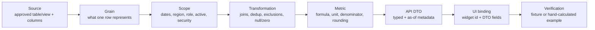
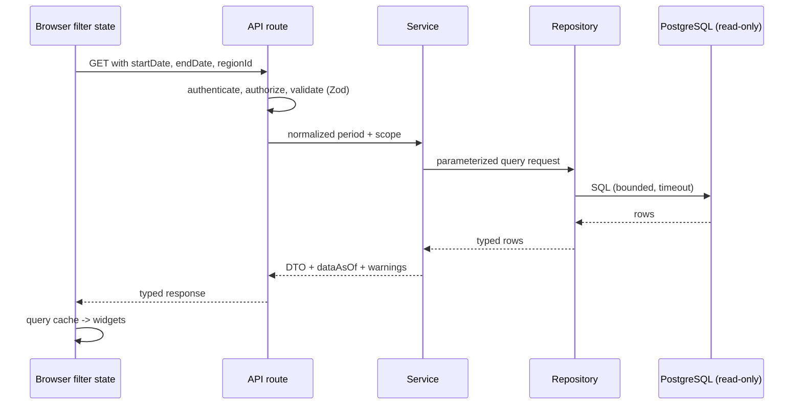
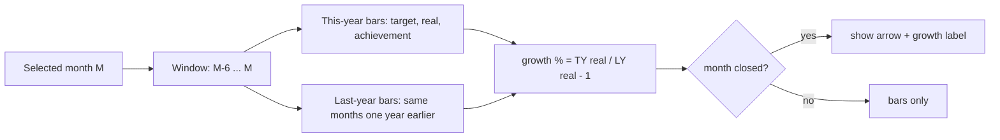

# Metrics Contract

Single source of truth for what every number on the dashboard means. Formulas marked `[P]` are provisional until the owner supplies the schema and a verified example. Authoritative calculations run on the **server**; the UI only renders them.

Related: [`PRD.md`](../PRD.md) · [`02-architecture.md`](02-architecture.md) · [`03-data-model.md`](03-data-model.md) · [`decisions.md`](decisions.md)

## 1. Metric catalogue

| ID | Metric | Definition | Status | Owner must confirm |
|---|---|---|---|---|
| METRIC-002 | Role total (RSM, ASM, SPV, SE) | Distinct entities at the role's level: RSM=region, ASM=branch, SPV=area, SE=`SLSNO` (see `03-data-model.md` 4.4) | `[R]` | Active flags, effective dates, SOA/SOI exclusion (DEC-028) |
| METRIC-003 | Role headcount (card) | Distinct eligible people in role and scope | `[P]` | Same as above; DIST vs SE |
| METRIC-004 | IN / OUT achieved count and % | An entity is achieved when its achievement >= working-day progress (same as the bar's green condition 1). `achieved_count / entity_count * 100` | `[C]` | Denominator for entities without data (DEC-004) |
| METRIC-005 | Sell IN achievement | `SUM(TOTALRealSellIn) / SUM(TOTALTargetSellIn) * 100` at the scope | `[R]` (Tableau) | Zero/missing target, unit (DEC-030) |
| METRIC-006 | Sell Out achievement | `SUM(TOTALRealSellOut) / SUM(TOTALTargetSellOut) * 100` | `[R]` (Tableau) | Zero/missing target, unit |
| METRIC-015 | Growth % (Sell IN / Sell Out) | `real(month, this year) / real(same month, last year) - 1` | `[R]` | Zero last-year handling (DEC-025) |
| METRIC-016 | Active distributors per region | `SUM(Total Aktif) / SUM(TOTAL DIST) * 100` from `distaktif` for the month; also show "active / total" | `[C]` | Source is a manual Excel upload: label it and expose staleness (`FIND-003`) |
| METRIC-017 | Upload status per distributor per day | Upload when a row with `Updated = 1` exists for that day | `[R]` | Weekend/holiday, stock variant (DEC-026) |
| METRIC-007 | Region scope | Approved region grouping and order | `[O]` | Keys, labels, hierarchy |
| METRIC-008 | Working-day progress | `SUM(networkeddays elapsed) / SUM(networkeddays in month) * 100` from `dimdate`, capped to 0-100 | `[C]` | Whether today counts as elapsed (DEC-037) |
| METRIC-009 | Display date | Current date in business timezone | `[P]` | Business timezone |

**Aggregation rule:** aggregate actual and target at the intended scope first, then divide. Never average row-level percentages unless the owner defines it. Never join facts from different grains before aggregating without a documented safe strategy.

## 2. Lineage chain (required for every dashboard item)



For each metric record: query location, query grain, filter behavior, and a test that detects double counting. The filled-in version of this chain lives in the source-mapping table in [`03-data-model.md`](03-data-model.md#4-source-mapping-template).

- `DATA-001` `[C]` Every dashboard item is traceable through the lineage chain above.
- `DATA-002` `[C]` Authoritative sales/financial values are calculated on the server, not the client.
- `DATA-003` `[C]` No production schema, joins or column names are assumed before the owner supplies them.
- `DATA-004` `[I]` Regions, roles, dashboards and widgets use stable IDs; labels may change without breaking saved configuration.

## 3. Data-quality policy

- `METRIC-010` `[C]` Zero is not unknown. A missing target never silently becomes 0 or 100%; show "unavailable" plus a data-quality note.
- `METRIC-011` `[O]` Define treatment of duplicate facts, inactive employees, missing region mapping, returns/negative sales, late-arriving or updated records.
- `METRIC-012` `[P]` Date inputs are date-only in the business timezone, inclusive start and end, translated to a half-open timestamp range internally when source columns are timestamps.
- `METRIC-013` `[C]` Compare unrounded values for all thresholds; round only the displayed label.
- `METRIC-014` `[P]` Every metric response carries `dataAsOf` (finish time of the last completed ETL run) and `generatedAt`; stale or incomplete results show a warning.
- `METRIC-018` `[C]` Source data is **monthly**, loaded by an ETL (about 3 hours per run, nightly today) that refreshes materialized views and stored procedures. The current month is **month-to-date as of the last completed refresh**; there is no day-level data and no "last month to date". Comparing the in-progress month with a full month is not like-for-like and is labelled so.

## 4. Conditional bar colors (owner-confirmed)

All requirements in this section are `[C]`.

Inputs: `achievement` (unrounded %), `workingDayProgress` (unrounded %, server-capped to 0-100), `warningMin` (default 70), `successMin` (default 100).

- `RULE-001` Evaluate in this order; first match wins: (1) `achievement >= workingDayProgress` -> **green**; (2) `achievement < warningMin` -> **red**; (3) `achievement < successMin` -> **yellow**; (4) otherwise **green** (fallback, unreachable once working-day progress is capped).
- `RULE-002` Equality with working-day progress counts as green.
- `RULE-003` Condition 1 can only produce green. Being behind working-day pace is not final red; the result falls through to the achievement band. Example: working day 80% and achievement 75% is **yellow**.
- `RULE-004` Green applies even when achievement is below 70%, if it is at or above working-day progress.
- `RULE-005` If working-day progress is missing, skip step 1, use the achievement band only, and show a data-quality warning. If achievement is missing, show neutral "unavailable", never red or green.
- `RULE-006` Thresholds, colors, boundary inclusivity and fallback are validated admin configuration (see [`03-data-model.md`](03-data-model.md#22-achievement-rule-set)); invalid saves are rejected and the last valid version stays active.
- `RULE-007` Status is also exposed as text or icon, never color alone.
- `RULE-008` `[R]` When working-day progress is 0, compare against a tiny epsilon (0.0001) so 0% achievement is not green (from Tableau `Color Working Days`). `[P]` pending confirmation (DEC-027).
- `RULE-009` `[C]` Boundary: 70% up to 99% is yellow, so exactly 70% is **yellow** (inclusive). Tableau used "greater than 70%"; the app follows the owner.

The Tableau formula for role bars (`%Capai RSM,ASM ColorSellIN`) is: green if achievement >= 100% or >= working-day progress; yellow if > 70%; else red. It matches the confirmed rule except for the 70% boundary, where the owner's rule wins.


```
status(ach, wd):
  if ach is null:                    return unavailable
  if wd is not null and ach >= wd:   return green
  if ach < warningMin:               return red
  if ach < successMin:               return yellow
  return green
```

**Reference test table** (WD = working-day progress, ACH = achievement):

| WD | ACH | Result | Reason |
|---|---|---|---|
| 80% | 75% | Yellow | ACH < WD, falls through; 70% <= ACH < 100% |
| 80% | 60% | Red | ACH < WD and ACH < 70% |
| 66.67% | 66.67% | Green | Equal counts as on-track |
| 66.67% | 66.66% | Red | ACH < WD and ACH < 70% |
| 90% | 70% | Yellow | Exactly 70% is in the yellow band |
| 90% | 69.99% | Red | Just below warning minimum |
| 90% | 99.99% | Yellow | Not yet 100% |
| 90% | 100% | Green | Band green |
| 40% | 50% | Green | ACH >= WD though ACH < 70% |
| 100% | 100% | Green | ACH >= WD |
| missing | 75% | Yellow | Skip step 1, band only, show warning |
| any | missing | Unavailable | Never red or green |

## 5. Item-by-item calculation contract

### 5.1 Start Date and End Date filters
**Purpose:** reporting period for all date-scoped metrics. **Inputs:** start month, end month (month granularity, `DASH-003`), optional dashboard filters. Tableau's `Start_Date` and `End_Date` are month parameters (default `2026-10-01`, shown as "Oct-26"). When Start and End span several months, role counts use entities x months as the denominator (Tableau divides by `COUNTD(entity) * (months between + 1)`); confirm in DEC-029.

- `METRIC-001` `[C]` Reject invalid format and start month > end month; invalid ranges issue no data query. Period values are months (first day of month internally).
- `[O]` Confirm the default date selection; do not assume "current month".
- One canonical filter object applies to all widgets whose scope includes the global date filter. Show the active period and provide reset-to-default. Filter persistence follows the rotation policy (DEC-010).
- Cancel stale requests; out-of-order responses must not overwrite newer ones.



**Acceptance:** changing either date updates every applicable KPI and chart consistently; boundaries match owner-approved examples.

### 5.2 Team totals: RSM, ASM, SPV, SE
`role_total(role, scope) = COUNT(DISTINCT approved_person_key)` for people in that role matching approved active/effective-date rules `[P]`.

**Must decide:** person key, role history, active rules, multi-role users, effective dating, region scope, roster at period vs current. Do not infer DIST = SE (DEC-002). **Acceptance:** each total matches an owner-approved source query and is stable when a label changes.

### 5.3 Role cards: RSM, ASM, SPV, DIST (or confirmed categories)
Each card shows role total plus separate IN and OUT summaries.

**Confirmed rule `[C]` (DEC-021):** role cards use the **same rule as the bars**. An entity is *achieved* when its achievement >= working-day progress, which is exactly the bar's green condition 1. Because the rule is live, the count is not sticky: if tomorrow working-day progress rises above an entity's achievement, it stops being counted and the card number drops (for example RSM IN can go from 1 to 0).

**Cross-check with the screenshot:** working-day progress 66.67%; only INA PULAU 1 Sell IN (77%) passes, so RSM IN = 1 of 5 = 20%; no Sell Out region passes, so RSM OUT = 0. The ASM, SPV and DIST cards cannot be cross-checked from the image (no per-branch, per-area or per-distributor values) and need a check against real data.

```
entity_achievement = SUM(TOTALRealSellIn) / SUM(TOTALTargetSellIn)   (per entity, per month)   [OUT uses Sell Out]
achieved_flag      = entity_achievement >= working_day_progress
role_total         = distinct entities at the role's level in the user's scope  (RSM=region, ASM=branch, SPV=area, DIST=selling point)
in_achieved_count  = SUM(achieved_flag)
in_achieved_pct    = in_achieved_count / role_total * 100            (multi-month: / (role_total * months))
```

- Zero headcount shows "—" or "No members", never NaN/Infinity.
- Unknown achievement (missing target) is neither achieved nor failed; show data-quality context and apply the approved denominator policy (DEC-004).
- Counts come from entity-level achievement values, not from an average role achievement.
- Tableau evaluates the flag with a fixed level of detail per month and entity, then sums.
- **Open:** whether SE appears on a card (the image shows DIST, header shows SE); DIST = selling point (DEC-002); the DIST card total (a distinct count from the database) can differ from the active-distributor total (manual upload in `distaktif`); both are shown as stored and differences are logged as findings (DEC-034, `08-data-findings.md`).

**Acceptance tests:** 0/0, 0/5, 1/5, 5/5, missing target, achievement exactly equal to working-day progress (counts), and a time-shift test: the same data with working-day progress moving from 66.67% to 70% changes RSM IN from 1 to 0.

### 5.4 Sell IN achievement bar
`sell_in_achievement_pct = aggregated_sell_in_actual / aggregated_sell_in_target * 100` `[P]`. Displayed as whole percent on bars `[R]`. **Data needed:** grain, actual and target measures, period alignment, region mapping, exclusions, target changes over time, zero/missing policy. **Acceptance:** equals the independently calculated approved example; tooltip shows actual, target, period when approved for display.

### 5.5 Sell Out achievement bar
Same contract with approved Sell Out definitions `[P]`. Test zero target, missing target, negative/adjusted facts, values above 100%.

### 5.6 Region selector / panels
- Region IDs, labels, order come from approved data or configuration (examples seen: INA JAWA 1/2, INA PULAU 1, INA SUMATERA 1/2); never hardcoded.
- Selecting a region scopes both Sell IN and Sell Out consistently; no mixed selections after a switch.
- Never double-count when showing regional and all-region totals together.
- Handle renamed, deleted and no-data regions. Focus and selected state are visible and announced.

### 5.7 Working-day progress indicator
Comes from the working-day table/calendar, **not** sales achievement `[C]`. Screenshot example: 66.67%.

`working_day_progress_pct = clamp(elapsed_working_days / total_working_days_in_period * 100, 0, 100)`

**Source `[C]` (DEC-027):** the `dimdate` table already holds the calculated working-day value (`networkeddays`). The app **does not compute a calendar**; it sums that column for the selected month.

```
total_working_days   = SUM(networkeddays) for dates in the selected month
elapsed_working_days = SUM(networkeddays) for dates in the selected month before today   (current month)
                       total_working_days                                                (past month)
                       0                                                                 (future month)
working_day_progress = clamp(elapsed / total * 100, 0, 100)
```

- Holidays and weekends are whatever `dimdate` says; the app has no calendar rules of its own.
- **Reference in Tableau `[R]`:** elapsed = sum for dates up to today, minus 1 for the current month (today is treated as incomplete). On 22-Oct-2026 the dashboard shows 66.67% = 18 / 27. "Before today" reproduces this whenever today is a working day; verify the 18 / 27 result against the real `dimdate` rows (DEC-037).
- Zero total working days: unavailable.
- When progress is 0 (first day of the month), color comparisons use a tiny epsilon (0.0001) so 0% achievement is not green (`RULE-008`, from Tableau `Color Working Days`).

**UI:** circular indicator, percent, label "Working-day progress", as-of date, tooltip. Never described as achievement progress. **Acceptance:** 3 of 5 elapsed -> 60%; reproduces 18/27 = 66.67% for 22-Oct-2026 from real `dimdate` rows; first/last day; past, current and future months; zero working days.

### 5.8 Display date and refresh metadata
- `[P]` Use the configured business timezone for the display date, not the browser's.
- Show data as-of separately from the display date.
- Stale data: non-blocking freshness indicator; last known good data only with clear stale status.
- Refresh interval and stale threshold are operational decisions (DEC-014).

### 5.9 Text and image widgets
User-authored content, not metrics. Store safe structured text with limited formatting, position, style tokens, optional links under a URL policy. Images store an approved asset reference, fit mode, position, overlay, and alt text where meaningful. No executable markup. Decorative backgrounds need contrast overlays and are hidden from screen readers. Provide a fallback when an asset is missing.

## 6. Growth metrics and rolling 7-month window

- `METRIC-015` `[R]` `growth_pct(m) = (real(m, year Y) - real(m, year Y-1)) / real(m, year Y-1)`; Tableau computes this with `ZN()` (null to 0) and a 12-month lookback. When last year's real is 0 or missing the result is undefined: show "n/a" (DEC-025).
- Window (`GROW-001` in `06-dashboard-catalog.md`) `[C]`: months `M-6 ... M` where `M` is the selected month (default the current business month), each with its last-year counterpart (`M-18 ... M-12`). Moving to the next month shifts the window by one month. Windows cross year boundaries chronologically.
- Growth labels (`GROW-003` in `06-dashboard-catalog.md`) `[R]`: only for closed months (Tableau `Filter until closing month`); the in-progress month shows bars without growth.
- Direction: positive shows an up arrow (green), negative a down arrow (white in the reference).
- Growth for Sell Out uses real Sell Out. Achievement % and colors on each bar follow section 4 / `06-dashboard-catalog.md` (DEC-023).



## 7. Tooltip contract (`DASH-001`, all `[C]`)

Every tooltip (mouse hover, keyboard focus, touch long-press) shows:

| Field | Meaning |
|---|---|
| Entity | Region (or role/distributor) and period (month, and year for growth bars) |
| Target | Aggregated target for the scope |
| Real | Aggregated actual for the scope |
| % | Achievement = real / target, using the display precision |
| Status | Text of the color status (for example "Behind pace") |

Growth points add last-year real, this-year real and growth %. Missing values read "unavailable". The tooltip values come from the same DTO as the bar, never recalculated in the UI. Unit and currency formatting: DEC-030.

## 8. Scope applies to every metric (DEC-011, DEC-036)

Every number is computed **inside the signed-in user's data scope** (allowed principals, regions and other scoped filters; see `02-architecture.md` section 10). A user limited to one region sees team totals, role cards, bars and active-distributor figures for that region only. Working-day progress is the same for everyone. A user cannot request data outside their scope by editing a URL or parameter; the server rejects or filters it.
