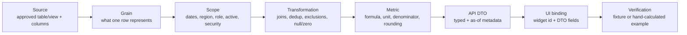
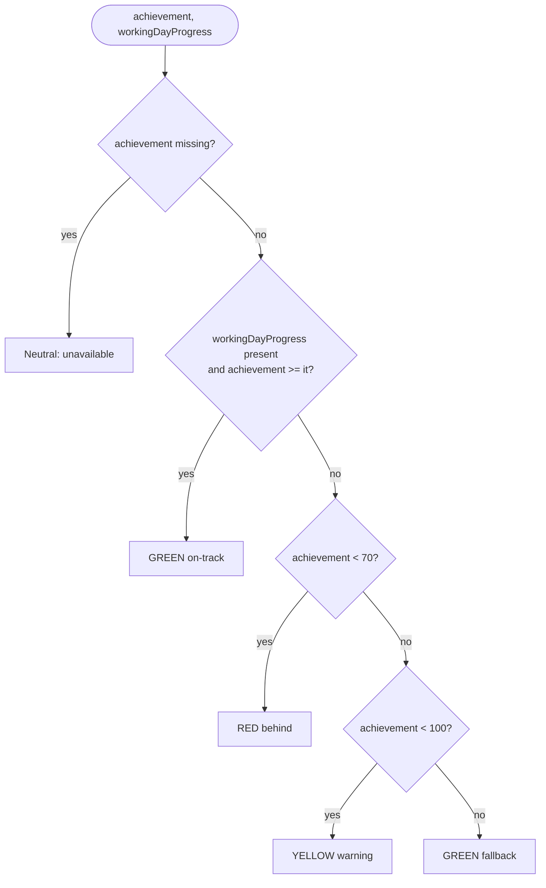
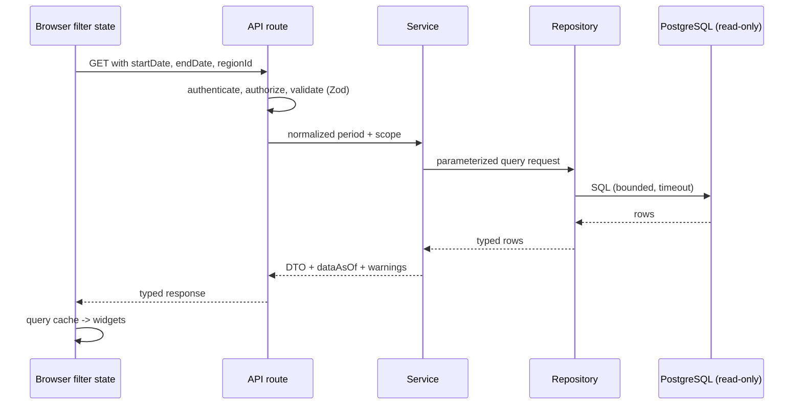

# Metrics Contract

Single source of truth for what every number on the dashboard means. Formulas marked `[P]` are provisional until the owner supplies the schema and a verified example. Authoritative calculations run on the **server**; the UI only renders them.

Related: [`PRD.md`](../PRD.md) · [`02-architecture.md`](02-architecture.md) · [`03-data-model.md`](03-data-model.md) · [`decisions.md`](decisions.md)

## 1. Metric catalogue

| ID | Metric | Definition | Status | Owner must confirm |
|---|---|---|---|---|
| METRIC-002 | Role total (RSM, ASM, SPV, SE) | `COUNT(DISTINCT person_key)` in role and scope | `[P]` | Person key, active/effective-date rules, roster as of period vs current |
| METRIC-003 | Role headcount (card) | Distinct eligible people in role and scope | `[P]` | Same as above; DIST vs SE |
| METRIC-004 | IN / OUT achieved count and % | `achieved_count / headcount * 100`, where achieved = person-level achievement >= 100% | `[C]` example, `[P]` rest | IN = Sell IN? OUT = Sell Out? Denominator for people without data |
| METRIC-005 | Sell IN achievement | `aggregated_actual / aggregated_target * 100` | `[P]` | Source fields, aggregation, zero/missing target |
| METRIC-006 | Sell Out achievement | Same, with Sell Out measures | `[P]` | Not assumed equal to shipment/invoice/sell-through |
| METRIC-007 | Region scope | Approved region grouping and order | `[O]` | Keys, labels, hierarchy |
| METRIC-008 | Working-day progress | `elapsed_working_days / total_working_days * 100`, capped to 0-100 | `[C]` source & cap, `[P]` rest | Calendar source, holidays, timezone, as-of rule |
| METRIC-009 | Display date | Current date in business timezone | `[P]` | Business timezone |

**Aggregation rule:** aggregate actual and target at the intended scope first, then divide. Never average row-level percentages unless the owner defines it. Never join facts from different grains before aggregating without a documented safe strategy.

## 2. Lineage chain (required for every dashboard item)



For each metric record: query location, query grain, filter behavior, and a test that detects double counting. The filled-in version of this chain lives in the source-mapping table in [`03-data-model.md`](03-data-model.md#4-source-mapping-template).

- `DATA-001` `[C]` Every dashboard item is traceable through the lineage chain above.
- `DATA-002` `[C]` Authoritative sales/financial values are calculated on the server, not the client.
- `DATA-003` `[C]` No production schema, joins or column names are assumed before the owner supplies them.
- `DATA-004` `[I]` Regions, roles, dashboards and widgets use stable IDs; labels may change without breaking saved configuration.

## 3. Data-quality policy

- `METRIC-010` `[C]` Zero is not unknown. A missing target never silently becomes 0 or 100%; show "unavailable" plus a data-quality note.
- `METRIC-011` `[O]` Define treatment of duplicate facts, inactive employees, missing region mapping, returns/negative sales, late-arriving or updated records.
- `METRIC-012` `[P]` Date inputs are date-only in the business timezone, inclusive start and end, translated to a half-open timestamp range internally when source columns are timestamps.
- `METRIC-013` `[C]` Compare unrounded values for all thresholds; round only the displayed label.
- `METRIC-014` `[P]` Every metric response carries `dataAsOf` and `generatedAt`; stale or incomplete results show a warning.

## 4. Conditional bar colors (owner-confirmed)

All requirements in this section are `[C]`.

Inputs: `achievement` (unrounded %), `workingDayProgress` (unrounded %, server-capped to 0-100), `warningMin` (default 70), `successMin` (default 100).

- `RULE-001` Evaluate in this order; first match wins: (1) `achievement >= workingDayProgress` -> **green**; (2) `achievement < warningMin` -> **red**; (3) `achievement < successMin` -> **yellow**; (4) otherwise **green** (fallback, unreachable once working-day progress is capped).
- `RULE-002` Equality with working-day progress counts as green.
- `RULE-003` Condition 1 can only produce green. Being behind working-day pace is not final red; the result falls through to the achievement band. Example: working day 80% and achievement 75% is **yellow**.
- `RULE-004` Green applies even when achievement is below 70%, if it is at or above working-day progress.
- `RULE-005` If working-day progress is missing, skip step 1, use the achievement band only, and show a data-quality warning. If achievement is missing, show neutral "unavailable", never red or green.
- `RULE-006` Thresholds, colors, boundary inclusivity and fallback are validated admin configuration (see [`03-data-model.md`](03-data-model.md#22-achievement-rule-set)); invalid saves are rejected and the last valid version stays active.
- `RULE-007` Status is also exposed as text or icon, never color alone.



```
status(ach, wd):
  if ach is null:                    return unavailable
  if wd is not null and ach >= wd:   return green
  if ach < warningMin:               return red
  if ach < successMin:               return yellow
  return green
```

**Reference test table** (WD = working-day progress, ACH = achievement):

| WD | ACH | Result | Reason |
|---|---|---|---|
| 80% | 75% | Yellow | ACH < WD, falls through; 70% <= ACH < 100% |
| 80% | 60% | Red | ACH < WD and ACH < 70% |
| 66.67% | 66.67% | Green | Equal counts as on-track |
| 66.67% | 66.66% | Red | ACH < WD and ACH < 70% |
| 90% | 70% | Yellow | Exactly 70% is in the yellow band |
| 90% | 69.99% | Red | Just below warning minimum |
| 90% | 99.99% | Yellow | Not yet 100% |
| 90% | 100% | Green | Band green |
| 40% | 50% | Green | ACH >= WD though ACH < 70% |
| 100% | 100% | Green | ACH >= WD |
| missing | 75% | Yellow | Skip step 1, band only, show warning |
| any | missing | Unavailable | Never red or green |

## 5. Item-by-item calculation contract

### 5.1 Start Date and End Date filters
**Purpose:** reporting period for all date-scoped metrics. **Inputs:** start date, end date, optional dashboard filters.

- `METRIC-001` `[C]` Reject invalid format and start > end; invalid ranges issue no data query.
- `[O]` Confirm the default date selection; do not assume "current month".
- One canonical filter object applies to all widgets whose scope includes the global date filter. Show the active period and provide reset-to-default. Filter persistence follows the rotation policy (DEC-010).
- Cancel stale requests; out-of-order responses must not overwrite newer ones.



**Acceptance:** changing either date updates every applicable KPI and chart consistently; boundaries match owner-approved examples.

### 5.2 Team totals: RSM, ASM, SPV, SE
`role_total(role, scope) = COUNT(DISTINCT approved_person_key)` for people in that role matching approved active/effective-date rules `[P]`.

**Must decide:** person key, role history, active rules, multi-role users, effective dating, region scope, roster at period vs current. Do not infer DIST = SE (DEC-002). **Acceptance:** each total matches an owner-approved source query and is stable when a label changes.

### 5.3 Role cards: RSM, ASM, SPV, DIST (or confirmed categories)
Each card shows role total plus separate IN and OUT summaries.

**Owner example `[C]`:** RSM (5), IN 20% / 1 means one of five RSMs has achievement >= 100%; 1/5*100 = 20%.

```
role_headcount    = distinct eligible people for role in scope
in_achieved_count = eligible people with approved IN achievement >= 100%
in_achieved_pct   = in_achieved_count / role_headcount * 100
out_achieved_count / out_achieved_pct: same with OUT
```

- Zero headcount shows "—" or "No members", never NaN/Infinity.
- Unknown achievement is neither achieved nor failed; show data-quality context and apply the approved denominator policy (DEC-004).
- Counts come from person-level achievement, not from an average role achievement.
- **Open:** IN = Sell IN? OUT = Sell Out? People without transactions in denominator? Exactly 100% qualifies (example says >=).

**Acceptance tests:** 0/0, 0/5, 1/5, 5/5, missing target, exactly 100%.

### 5.4 Sell IN achievement bar
`sell_in_achievement_pct = aggregated_sell_in_actual / aggregated_sell_in_target * 100` `[P]`. Displayed as whole percent on bars `[R]`. **Data needed:** grain, actual and target measures, period alignment, region mapping, exclusions, target changes over time, zero/missing policy. **Acceptance:** equals the independently calculated approved example; tooltip shows actual, target, period when approved for display.

### 5.5 Sell Out achievement bar
Same contract with approved Sell Out definitions `[P]`. Test zero target, missing target, negative/adjusted facts, values above 100%.

### 5.6 Region selector / panels
- Region IDs, labels, order come from approved data or configuration (examples seen: INA JAWA 1/2, INA PULAU 1, INA SUMATERA 1/2); never hardcoded.
- Selecting a region scopes both Sell IN and Sell Out consistently; no mixed selections after a switch.
- Never double-count when showing regional and all-region totals together.
- Handle renamed, deleted and no-data regions. Focus and selected state are visible and announced.

### 5.7 Working-day progress indicator
Comes from the working-day table/calendar, **not** sales achievement `[C]`. Screenshot example: 66.67%.

`working_day_progress_pct = clamp(elapsed_working_days / total_working_days_in_period * 100, 0, 100)`

**Policy still needed:** business timezone, as-of date, inclusive boundaries, holidays, weekends, partial and future periods, zero working days. **Proposed defaults** (DEC-006): period fully in the past -> 100%; fully in the future -> 0%; zero working days -> unavailable. The API is authoritative and returns calculation metadata.

**UI:** circular indicator, percent, label "Working-day progress", as-of date, tooltip. Never described as achievement progress. **Acceptance:** 3 of 5 elapsed -> 60%; weekends/holidays; first/last day; future dates; zero working days.

### 5.8 Display date and refresh metadata
- `[P]` Use the configured business timezone for the display date, not the browser's.
- Show data as-of separately from the display date.
- Stale data: non-blocking freshness indicator; last known good data only with clear stale status.
- Refresh interval and stale threshold are operational decisions (DEC-014).

### 5.9 Text and image widgets
User-authored content, not metrics. Store safe structured text with limited formatting, position, style tokens, optional links under a URL policy. Images store an approved asset reference, fit mode, position, overlay, and alt text where meaningful. No executable markup. Decorative backgrounds need contrast overlays and are hidden from screen readers. Provide a fallback when an asset is missing.
