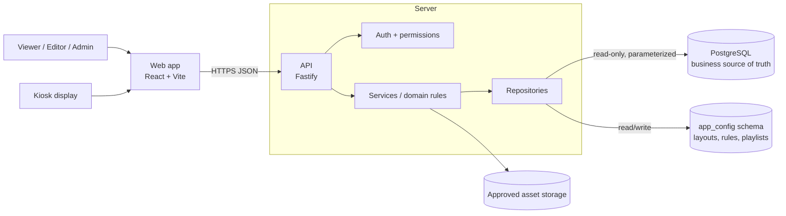
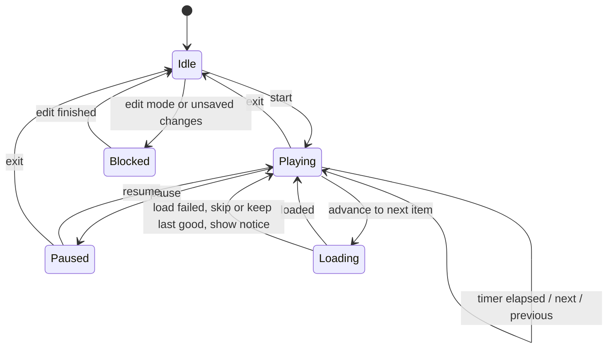
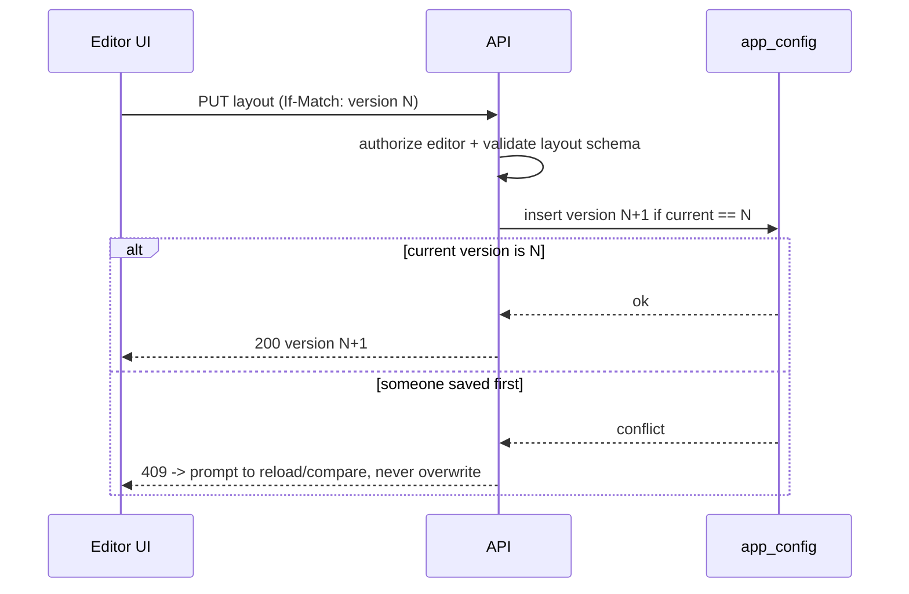
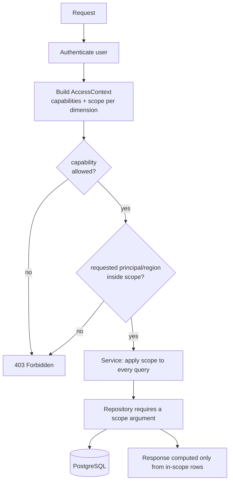
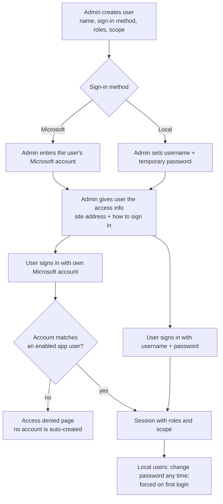

# Architecture

Related: [`PRD.md`](../PRD.md) · [`01-metrics-contract.md`](01-metrics-contract.md) · [`03-data-model.md`](03-data-model.md)

The repository currently contains no application code, so this is a greenfield project. The stack below is the **chosen starting point** (`[I]`); change it only with a recorded decision. Verify current package versions and compatibility at Phase 1 start and pin them in the lockfile; do not copy version numbers into documents.

## 1. System context



Rules: no SQL in the browser; no database credentials in the browser; business tables are read-only for the app; app-owned configuration lives in a separate schema (see `03-data-model.md`).

## 2. Stack

**Frontend:** Node.js current LTS (pinned) · Vite + React + TypeScript (strict) · Tailwind CSS · shadcn/ui on Radix primitives · lucide-react · React Router · TanStack Query (server state, caching, cancellation) · Zustand (client-only state: editor selection, theme UI, rotation) · React Hook Form + Zod · Apache ECharts + echarts-for-react · react-grid-layout behind a local adapter · date-fns (presentation only) · one typed fetch wrapper (ky or native, pick one).

**Backend:** Fastify + TypeScript · `pg` with pooling, timeouts, bounded results · Drizzle ORM + drizzle-kit for app-owned tables only (`app_config`) · Zod at request, response and config boundaries · Pino with redaction · `@fastify/helmet`, `@fastify/cors`, `@fastify/rate-limit` · `@fastify/swagger` + UI for API contracts · least-privilege DB credentials.

**Quality and delivery:** pnpm workspaces · Vitest, Testing Library, user-event, jest-axe · Playwright (Chromium and Firefox) · ESLint, typescript-eslint, Prettier · CI: frozen-lockfile install, lint, typecheck, unit tests, build, E2E.

**Do not add** Redux, a second charting library, overlapping form libraries or a second ORM without a documented need.

## 3. Repository layout (proposed)

```
apps/web/                  React + Vite UI
apps/api/                  Fastify API (routes, services, repositories)
packages/contracts/        Shared DTOs and Zod schemas
packages/dashboard-core/   Metric types, layout schema, threshold evaluation, playlist state machine
packages/config/           Shared tooling config
docs/                      Specification (this folder)
fixtures/                  Clearly labelled MOCK data and golden test cases
```

Modular monolith, not microservices. Route handlers stay thin. Never duplicate working-day or metric formulas across layers.

## 4. Layering

| Layer | Responsibility |
|---|---|
| Route | Authentication/authorization, input parsing, response mapping |
| Service / domain | Business rules, calculations, state-transition validation |
| Repository | Parameterized PostgreSQL access, query-specific aggregation |
| Contract | Request/response DTOs, Zod schemas, stable error shape |
| Configuration | Environment variables, safe runtime defaults |

**Repository interface pattern:** services depend on interfaces (for example `MetricsRepository`). Provide a `MockMetricsRepository` (reads `fixtures/`) now and a `PgMetricsRepository` after the schema is approved. This lets the UI and API be built and tested end to end without guessing the schema.

## 5. Frontend component boundaries

| Component | Responsibility |
|---|---|
| `AppShell` | Layout, sidebar, top bar, route outlet |
| `DashboardRoute` | Loads dashboard metadata, route-level states |
| `GlobalFilterBar` | Date filters and shared filter state |
| `DashboardGrid` | Renders layout from validated widget definitions |
| `WidgetRenderer` | Resolves an allowlisted widget type to a component |
| `KpiCard`, `AchievementBarChart`, `WorkingDayProgress` | Presentational only; receive calculated values and statuses |
| `DashboardEditor` | Drag/resize/add/remove, layout draft state |
| `ThemeProvider` | Light/dark/system tokens and persistence |
| `RotationController` | Playlist state machine and timing, independent of charts |
| `AdminSettings` | Validated forms for rules and playlists |

Domain modules own: metric DTOs and formatting, achievement formulas, role count logic, working-day semantics, threshold evaluation, layout schema/versioning, playlist validation and transitions. Presentation components never query PostgreSQL, contain SQL, infer formulas, or own rotation timers.

## 6. API contract (proposed; none exist yet)

| Method and path | Purpose | Permission |
|---|---|---|
| `GET /api/health` | Liveness/readiness | Public |
| `GET /api/me/access` | Signed-in user's capabilities and data scope (allowed principals, regions, dashboards); drives which buttons and filter options the UI shows | Authenticated |
| `GET/POST/PUT /api/admin/roles`, `/api/admin/users/:id/roles`, `/api/admin/scopes` | Manage roles, capabilities, data scopes and user assignments | `access.manage` |
| `GET /api/dashboards` | List dashboards | Viewer+ |
| `GET /api/dashboards/:dashboardId` | Dashboard definition + active layout | Viewer+ |
| `GET /api/sales-performance/summary?principalId=&startMonth=&endMonth=&regionId=` | Team totals, role cards | Viewer+ |
| `GET /api/sales-performance/regions?principalId=&startMonth=&endMonth=&regionId=` | Sell IN / Sell Out per region with statuses | Viewer+ |
| `GET /api/calendar/working-day-progress?month=&asOfDate=` | Working-day progress + metadata | Viewer+ |
| `GET /api/sales-performance/growth?principalId=&month=&window=7&metric=sellIn\|sellOut` | Rolling-window growth matrix (`DASH-002`) | Viewer+ |
| `GET /api/sales-performance/active-distributors?principalId=&month=` | Active / total distributors per region | Viewer+ |
| `GET /api/uploads/daily?principalId=&month=&regionId=&branchId=&kind=sales\|stock` | Daily upload grid | Viewer+ |
| `GET/PUT /api/settings/achievement-rules` | Rule set | Admin |
| `GET/POST/PUT /api/playlists` | Playlists | Admin (read: Viewer+) |
| `PUT /api/dashboards/:id/layout` with `If-Match: <version>` | Save layout (optimistic concurrency) | Editor+ |
| Asset list/upload | After storage is approved | Admin |
| `POST /api/ai/chat`, `GET /api/ai/sessions`, `GET /api/ai/results/:id`, `POST /api/ai/results/:id/refresh` | AI data chat (`07-ai-chat.md`) | `ai.chat.use` |
| `GET /api/findings`, `PUT /api/findings/:id` | Data findings (`08-data-findings.md`) | `findings.view` / `findings.manage` |
| `POST /api/auth/login`, `POST /api/auth/change-password`, `GET /api/auth/microsoft/callback` | Local login, password change, Microsoft sign-in | Public / Authenticated |

Every endpoint documents purpose, permissions, filters, response fields, errors, cache policy and freshness. Never return SQL, connection strings, stack traces or internal sensitive identifiers.

**Response envelope for metric endpoints:**

```json
{
  "data": { },
  "period": { "startMonth": "2026-10", "endMonth": "2026-10", "timezone": "TBD" },
  "filtersApplied": { "principalId": "INA", "regionId": null },
  "dataAsOf": "2026-10-21T23:00:00Z",
  "generatedAt": "2026-10-22T05:31:00Z",
  "warnings": [ { "code": "MISSING_TARGET", "scope": "region-002" } ]
}
```

**Error shape (stable):**

```json
{ "error": { "code": "VALIDATION_ERROR", "message": "Start date must not be after end date.", "requestId": "..." } }
```

Validate configuration on read and write; malformed persisted configuration falls back safely and logs an operational warning.

## 7. Rotation state machine

One controller, one timer. Clean up timers/listeners on every transition.



## 8. Layout save flow (concurrency)



## 9. Security, performance, observability

- `SEC-001` `[C]` Permissions enforced on the server; filters and identifiers allowlisted; all queries parameterized.
- `SEC-002` `[C]` Credentials stay server-side; metric queries use a read-only least-privilege account.
- `SEC-003` `[P]` Restrictive CORS, security headers, rate limits, request timeouts, safe errors, redacted logs.
- `SEC-004` `[P]` Validate image uploads (type, size, dimensions); no unsafe external URLs, path traversal or arbitrary HTML.
- `SEC-005` `[O]` Authentication provider and kiosk credential model (DEC-007, DEC-012).
- `OPS-001` `[P]` Aim for LCP <= 2.5 s; set API latency targets once data volume and hosting are known.
- `OPS-002` `[P]` Fetch active dashboard data first; prefetch only the next rotation item when safe.
- `OPS-003` `[P]` Structured logs with request IDs, health endpoint, error tracking, query timing.

## 10. Access control: configurable, not hard-coded (DEC-011, DEC-022, DEC-036)

**Owner requirement:** the web has principal buttons (ASW, INA). Admins decide, per role and per user, which principals, regions and other filters each person can use. Some users see one principal, some both (full access); some see one region, some several. Roles and permissions are managed in an admin screen and stored as data.

### 10.1 Model

- **Capabilities** are the things the code checks: actions (`layout.edit`, `rules.manage`, `playlist.manage`, `access.manage`, `findings.manage`), **features** (`dashboard.view` per dashboard, `ai.chat.use`, `findings.view`) and **filters** (`filter.principal`, `filter.region`, `filter.branch`, and so on). The catalog is fixed in code because code must check each item (a brand-new feature registers its capability when it ships); **who has each one is data**, and admins can turn any of them on or off per role at any time.
- **Filter policy per role:** each filter is `hidden`, `locked` (fixed to the role's scope value) or `editable` within the allowed values.
- **Roles** are created, renamed and deleted by admins. A role = a set of capabilities + a data scope.
- **Data scope** is, per scope dimension, either `all` or an explicit list of values. Dimensions come from a registry: `principal`, `region`, `branch`, `dashboard` (extendable without changing route code).
- **"Full access"** is `principal: all` (and `region: all`) on a role, not a hard-coded role name.
- **Users** get one or more roles; an optional per-user override can add or remove scope values.
- **Effective access** = union of the user's roles (capabilities and scope values per dimension), then user overrides. No role, or an empty scope, means **no access** (deny by default).
- Principals, regions and branches are values read from approved data or the principal registry (`03-data-model.md` 2.6). They are never listed in code or in UI components.

### 10.2 Enforcement (server only)



- `SEC-006` `[C]` Permissions and data scope are resolved on the server for every request; hiding buttons in the UI is never the control.
- `SEC-007` `[C]` Repositories take a mandatory scope argument; there is no code path that queries business tables without it.
- `SEC-008` `[C]` All totals, role cards, bars and active-distributor figures are computed within scope (`01-metrics-contract.md` section 8). When a filter is not supplied, the default is "all values the user is allowed", never "everything".
- `SEC-009` `[P]` Cache keys include a hash of the scope, so one user's cached result is never served to a user with a different scope.
- `SEC-010` `[P]` Changes to roles, capabilities, scopes and user assignments are audited (who, what, when) and take effect on the next request or within a short, documented cache window.
- `SEC-011` `[C]` The admin UI manages roles, capabilities, scopes and assignments with validation (cannot remove the last user holding `access.manage`).
- `SEC-012` `[P]` Seed roles for first use (for example Viewer, Editor, Administrator, Display) are ordinary editable data, not special-cased in code.
- `SEC-013` `[C]` Users are created by an admin and signed in through Microsoft or local credentials (section 11); permissions key off the app's own user id, linked to the sign-in identity.
- `SEC-014` `[C]` **Admin has full control** over what each role may use: switch features and filters on or off, and change a role's capabilities and scope after the role or user was created. Changes apply to existing users of that role.

### 10.3 What the UI does with scope

- Principal buttons show only allowed principals; with exactly one allowed, it is preselected and the control is a static label.
- Region, branch and similar filters list only allowed values; with exactly one allowed, preselected.
- A playlist or layout shared across users still renders per viewer scope; a dashboard the viewer is not allowed to see is skipped in rotation.
- Kiosk displays use a display credential that is itself a user-like identity with its own role and scope (DEC-012).

## 11. Authentication: Microsoft account or local username/password (DEC-007)

**Owner requirements `[C]`:** the admin creates the user and links a Microsoft account; after the admin sets the role and gives the user the access information, the user signs in with their **own Microsoft account**. If a person has no Microsoft account, the admin creates a **username and password**; the user can **change the password after login**.

### 11.1 User lifecycle



- `AUTH-001` `[C]` Only users created by an admin can sign in. A valid Microsoft account that is not linked to an enabled app user is denied; nothing is created automatically.
- `AUTH-002` `[C]` Microsoft sign-in uses Microsoft Entra ID (OpenID Connect, authorization code with PKCE). The server validates issuer, audience, tenant and signature. After first link, matching uses the tenant id and the immutable object id, not the email address, which can change.
- `AUTH-003` `[C]` Local accounts (username and password) exist for people without a Microsoft account. The user can change their password after login.
- `AUTH-004` `[P]` Local password rules: hashed with Argon2id; the admin-set password is temporary and must be changed at first login; minimum length and a breached-password check; rate limiting and temporary lockout after repeated failures; the password is shown to the admin once and never stored or logged in clear text; admin can reset or disable an account.
- `AUTH-005` `[P]` One sign-in method per user by default (admin chooses); allowing both is an admin option.
- `AUTH-006` `[C]` After the admin sets the role, the admin screen shows an **onboarding information** block to copy: site address, sign-in method, and for local users the username (and the temporary password once). Sending it by email is optional and open (DEC-038).
- `AUTH-007` `[P]` Sessions use HttpOnly, Secure, SameSite cookies, CSRF protection, idle and absolute timeouts; sign-out; every sign-in, failure, lockout and password change is audited without secrets.
- `AUTH-008` `[P]` Kiosk displays use their own revocable credential (DEC-012), not a person's account.
- `AUTH-009` `[O]` Microsoft tenant: single organization or several, who registers the app, redirect addresses, and whether MFA is enforced in Microsoft (DEC-038). Multi-factor for local accounts is open (DEC-039).

## 12. AI service boundary

The AI chat (`07-ai-chat.md`) is a server module: `/api/ai/chat` builds the user's AccessContext, calls the LLM provider with a catalog of read-only data tools (no SQL, no credentials), validates tool arguments, runs tools through the same services and repositories as the dashboards, verifies every number in the answer against tool results, and returns structured result blocks. Provider keys stay server-side. Chat history and results are stored per user (`03-data-model.md` section 3). New endpoints: `POST /api/ai/chat`, `GET /api/ai/sessions`, `GET /api/ai/results/:resultId`, `POST /api/ai/results/:resultId/refresh`.
