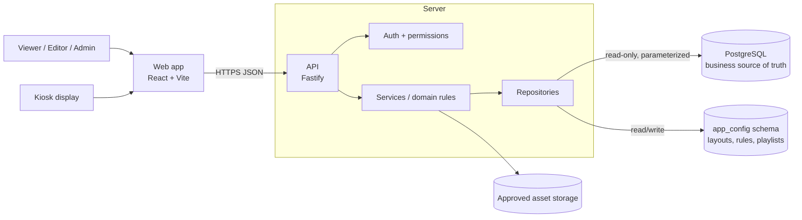
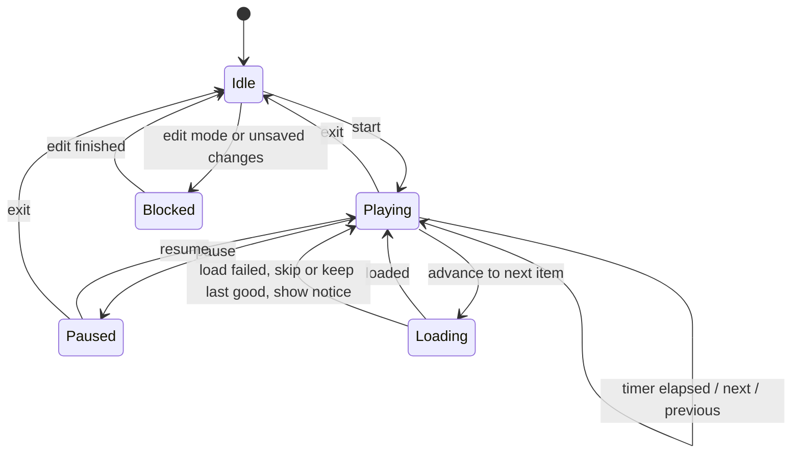
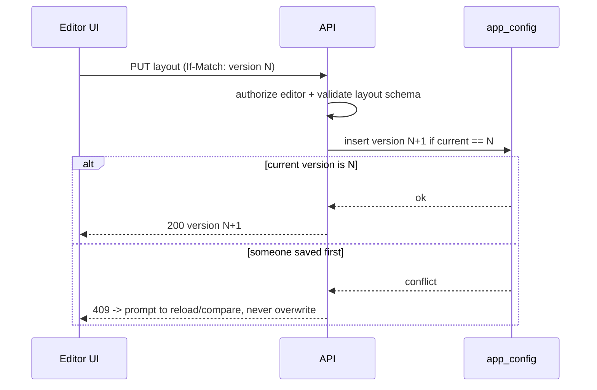
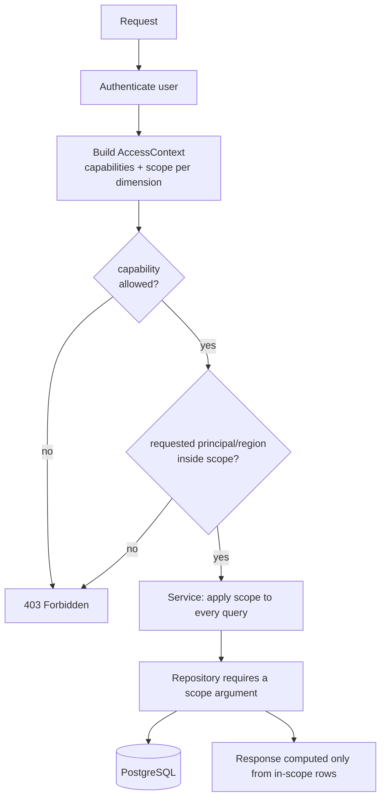
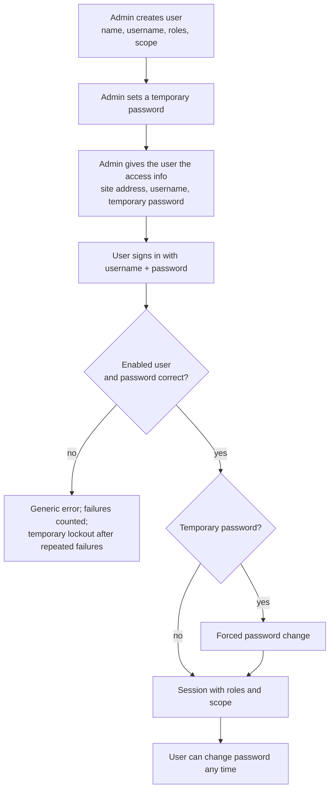
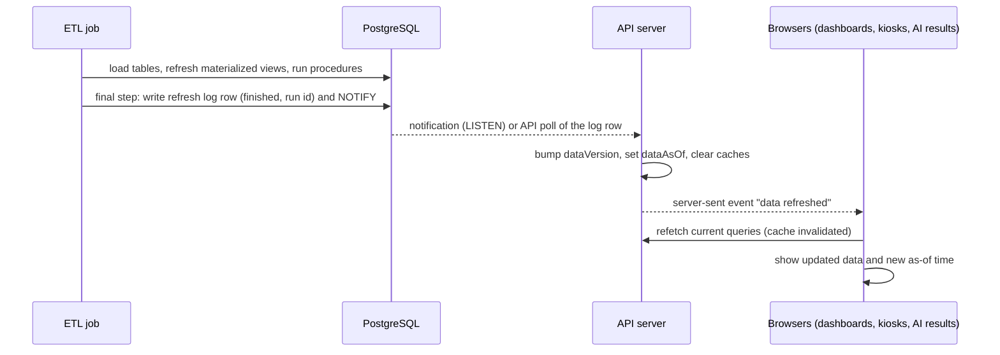

# Architecture

Related: [`PRD.md`](../PRD.md) · [`01-metrics-contract.md`](01-metrics-contract.md) · [`03-data-model.md`](03-data-model.md)

The repository currently contains no application code, so this is a greenfield project. The stack below is the **chosen starting point** (`[I]`); change it only with a recorded decision. Verify current package versions and compatibility at Phase 1 start and pin them in the lockfile; do not copy version numbers into documents.

## 1. System context



Rules: no SQL in the browser; no database credentials in the browser; business tables are read-only for the app; app-owned configuration lives in a separate schema (see `03-data-model.md`).

## 2. Stack

**Frontend:** Node.js current LTS (pinned) · Vite + React + TypeScript (strict) · Tailwind CSS · shadcn/ui on Radix primitives · lucide-react · React Router · TanStack Query (server state, caching, cancellation) · Zustand (client-only state: editor selection, theme UI, rotation) · React Hook Form + Zod · Apache ECharts + echarts-for-react · react-grid-layout behind a local adapter · date-fns (presentation only) · one typed fetch wrapper (ky or native, pick one).

**Backend:** Fastify + TypeScript · `pg` with pooling, timeouts, bounded results · Drizzle ORM + drizzle-kit for app-owned tables only (`app_config`) · Zod at request, response and config boundaries · Pino with redaction · `@fastify/helmet`, `@fastify/cors`, `@fastify/rate-limit` · `@fastify/swagger` + UI for API contracts · least-privilege DB credentials.

**Quality and delivery:** pnpm workspaces · Vitest, Testing Library, user-event, jest-axe · Playwright (Chromium and Firefox) · ESLint, typescript-eslint, Prettier · CI: frozen-lockfile install, lint, typecheck, unit tests, build, E2E.

**Do not add** Redux, a second charting library, overlapping form libraries or a second ORM without a documented need.

## 3. Repository layout (proposed)

```
apps/web/                  React + Vite UI
apps/api/                  Fastify API (routes, services, repositories)
packages/contracts/        Shared DTOs and Zod schemas
packages/dashboard-core/   Metric types, layout schema, threshold evaluation, playlist state machine
packages/config/           Shared tooling config
docs/                      Specification (this folder)
fixtures/                  Clearly labelled MOCK data and golden test cases
```

Modular monolith, not microservices. Route handlers stay thin. Never duplicate working-day or metric formulas across layers.

## 4. Layering

| Layer | Responsibility |
|---|---|
| Route | Authentication/authorization, input parsing, response mapping |
| Service / domain | Business rules, calculations, state-transition validation |
| Repository | Parameterized PostgreSQL access, query-specific aggregation |
| Contract | Request/response DTOs, Zod schemas, stable error shape |
| Configuration | Environment variables, safe runtime defaults |

**Repository interface pattern:** services depend on interfaces (for example `MetricsRepository`). Provide a `MockMetricsRepository` (reads `fixtures/`) now and a `PgMetricsRepository` after the schema is approved. This lets the UI and API be built and tested end to end without guessing the schema.

## 5. Frontend component boundaries

| Component | Responsibility |
|---|---|
| `AppShell` | Layout, sidebar, top bar, route outlet |
| `DashboardRoute` | Loads dashboard metadata, route-level states |
| `GlobalFilterBar` | Date filters and shared filter state |
| `DashboardGrid` | Renders layout from validated widget definitions |
| `WidgetRenderer` | Resolves an allowlisted widget type to a component |
| `KpiCard`, `AchievementBarChart`, `WorkingDayProgress` | Presentational only; receive calculated values and statuses |
| `DashboardEditor` | Drag/resize/add/remove, layout draft state |
| `ThemeProvider` | Light/dark/system tokens and persistence |
| `RotationController` | Playlist state machine and timing, independent of charts |
| `AdminSettings` | Validated forms for rules and playlists |

Domain modules own: metric DTOs and formatting, achievement formulas, role count logic, working-day semantics, threshold evaluation, layout schema/versioning, playlist validation and transitions. Presentation components never query PostgreSQL, contain SQL, infer formulas, or own rotation timers.

## 6. API contract (proposed; none exist yet)

| Method and path | Purpose | Permission |
|---|---|---|
| `GET /api/health` | Liveness/readiness | Public |
| `GET /api/me/access` | Signed-in user's capabilities and data scope (allowed principals, regions, dashboards); drives which buttons and filter options the UI shows | Authenticated |
| `GET/POST/PUT/DELETE /api/admin/ai-providers`, `POST /api/admin/ai-providers/:id/test`, `PUT /api/admin/ai-settings` | AI provider profiles, API key (write-only), tests, global AI settings | `ai.settings.manage` |
| `GET /api/data-version`, `GET /api/events` (server-sent events) | Current data version and as-of; push notice when a data refresh finishes | Authenticated |
| `GET/POST/PUT /api/admin/roles`, `/api/admin/users/:id/roles`, `/api/admin/scopes` | Manage roles, capabilities, data scopes and user assignments | `access.manage` |
| `GET /api/dashboards` | List dashboards | Viewer+ |
| `GET /api/dashboards/:dashboardId` | Dashboard definition + active layout | Viewer+ |
| `GET /api/sales-performance/summary?principalId=&startMonth=&endMonth=&regionId=` | Team totals, role cards | Viewer+ |
| `GET /api/sales-performance/regions?principalId=&startMonth=&endMonth=&regionId=` | Sell IN / Sell Out per region with statuses | Viewer+ |
| `GET /api/calendar/working-day-progress?month=&asOfDate=` | Working-day progress + metadata | Viewer+ |
| `GET /api/sales-performance/growth?principalId=&month=&window=7&metric=sellIn\|sellOut` | Rolling-window growth matrix (`DASH-002`) | Viewer+ |
| `GET /api/sales-performance/active-distributors?principalId=&month=` | Active / total distributors per region | Viewer+ |
| `GET /api/uploads/daily?principalId=&month=&regionId=&branchId=&kind=sales\|stock` | Daily upload grid | Viewer+ |
| `GET/PUT /api/settings/achievement-rules` | Rule set | Admin |
| `GET/POST/PUT /api/playlists` | Playlists | Admin (read: Viewer+) |
| `PUT /api/dashboards/:id/layout` with `If-Match: <version>` | Save layout (optimistic concurrency) | Editor+ |
| Asset list/upload | After storage is approved | Admin |
| `POST /api/ai/chat`, `GET /api/ai/sessions`, `GET /api/ai/results/:id`, `POST /api/ai/results/:id/refresh` | AI data chat (`07-ai-chat.md`) | `ai.chat.use` |
| `GET /api/findings`, `PUT /api/findings/:id` | Data findings (`08-data-findings.md`) | `findings.view` / `findings.manage` |
| `POST /api/auth/login`, `POST /api/auth/mfa/verify`, `POST /api/auth/mfa/enroll`, `PUT /api/admin/users/:id/mfa` (enable, disable, reset), `POST /api/auth/change-password`, `POST /api/auth/logout` | Local login, password change, sign-out (Microsoft callback added only when that provider is) | Public / Authenticated |

Every endpoint documents purpose, permissions, filters, response fields, errors, cache policy and freshness. Never return SQL, connection strings, stack traces or internal sensitive identifiers.

**Response envelope for metric endpoints:**

```json
{
  "data": { },
  "period": { "startMonth": "2026-10", "endMonth": "2026-10", "timezone": "TBD" },
  "filtersApplied": { "principalId": "INA", "regionId": null },
  "dataAsOf": "2026-10-21T23:00:00Z",
  "generatedAt": "2026-10-22T05:31:00Z",
  "warnings": [ { "code": "MISSING_TARGET", "scope": "region-002" } ]
}
```

**Error shape (stable):**

```json
{ "error": { "code": "VALIDATION_ERROR", "message": "Start date must not be after end date.", "requestId": "..." } }
```

Validate configuration on read and write; malformed persisted configuration falls back safely and logs an operational warning.

## 7. Rotation state machine

One controller, one timer. Clean up timers/listeners on every transition.



## 8. Layout save flow (concurrency)



## 9. Security, performance, observability

- `SEC-001` `[C]` Permissions enforced on the server; filters and identifiers allowlisted; all queries parameterized.
- `SEC-002` `[C]` Credentials stay server-side; metric queries use a read-only least-privilege account.
- `SEC-003` `[P]` Restrictive CORS, security headers, rate limits, request timeouts, safe errors, redacted logs.
- `SEC-004` `[P]` Validate image uploads (type, size, dimensions); no unsafe external URLs, path traversal or arbitrary HTML.
- `SEC-005` `[O]` Authentication provider and kiosk credential model (DEC-007, DEC-012).
- `OPS-001` `[P]` Aim for LCP <= 2.5 s; set API latency targets once data volume and hosting are known.
- `OPS-002` `[P]` Fetch active dashboard data first; prefetch only the next rotation item when safe.
- `OPS-003` `[P]` Structured logs with request IDs, health endpoint, error tracking, query timing.

## 10. Access control: configurable, not hard-coded (DEC-011, DEC-022, DEC-036)

**Owner requirement:** the web has principal buttons (ASW, INA). Admins decide, per role and per user, which principals, regions and other filters each person can use. Some users see one principal, some both (full access); some see one region, some several. Roles and permissions are managed in an admin screen and stored as data.

### 10.1 Model

- **Capabilities** are the things the code checks: actions (`layout.edit`, `rules.manage`, `playlist.manage`, `access.manage`, `findings.manage`, `ai.settings.manage`, `mfa.manage`), **features** (`dashboard.view` per dashboard, `ai.chat.use`, `findings.view`) and **filters** (`filter.principal`, `filter.region`, `filter.branch`, and so on). The catalog is fixed in code because code must check each item (a brand-new feature registers its capability when it ships); **who has each one is data**, and admins can turn any of them on or off per role at any time.
- **Filter policy per role:** each filter is `hidden`, `locked` (fixed to the role's scope value) or `editable` within the allowed values.
- **Roles** are created, renamed and deleted by admins. A role = a set of capabilities + a data scope.
- **Data scope** is, per scope dimension, either `all` or an explicit list of values. Dimensions come from a registry: `principal`, `region`, `branch`, `dashboard` (extendable without changing route code).
- **"Full access"** is `principal: all` (and `region: all`) on a role, not a hard-coded role name.
- **Users** get one or more roles; an optional per-user override can add or remove scope values.
- **Effective access** = union of the user's roles (capabilities and scope values per dimension), then user overrides. No role, or an empty scope, means **no access** (deny by default).
- Principals, regions and branches are values read from approved data or the principal registry (`03-data-model.md` 2.6). They are never listed in code or in UI components.

### 10.2 Enforcement (server only)



- `SEC-006` `[C]` Permissions and data scope are resolved on the server for every request; hiding buttons in the UI is never the control.
- `SEC-007` `[C]` Repositories take a mandatory scope argument; there is no code path that queries business tables without it.
- `SEC-008` `[C]` All totals, role cards, bars and active-distributor figures are computed within scope (`01-metrics-contract.md` section 8). When a filter is not supplied, the default is "all values the user is allowed", never "everything".
- `SEC-009` `[P]` Cache keys include a hash of the scope, so one user's cached result is never served to a user with a different scope.
- `SEC-010` `[P]` Changes to roles, capabilities, scopes and user assignments are audited (who, what, when) and take effect on the next request or within a short, documented cache window.
- `SEC-011` `[C]` The admin UI manages roles, capabilities, scopes and assignments with validation (cannot remove the last user holding `access.manage`).
- `SEC-012` `[P]` Seed roles for first use (for example Viewer, Editor, Administrator, Display) are ordinary editable data, not special-cased in code.
- `SEC-013` `[C]` Users are created by an admin and sign in with local credentials in release 1 (section 11); permissions key off the app's own user id, so adding Microsoft later does not change roles or scopes.
- `SEC-014` `[C]` **Admin has full control** over what each role may use: switch features and filters on or off, and change a role's capabilities and scope after the role or user was created. Changes apply to existing users of that role.

### 10.3 What the UI does with scope

- Principal buttons show only allowed principals; with exactly one allowed, it is preselected and the control is a static label.
- Region, branch and similar filters list only allowed values; with exactly one allowed, preselected.
- A playlist or layout shared across users still renders per viewer scope; a dashboard the viewer is not allowed to see is skipped in rotation.
- Kiosk displays use a display credential that is itself a user-like identity with its own role and scope (DEC-012).

## 11. Authentication: admin-created local accounts (DEC-007)

**Owner decision `[C]`:** there is no Microsoft administrator, so **Microsoft sign-in is skipped for now.** Release 1 uses **username and password accounts created by an admin**; users can change their own password after login. Authentication sits behind an `AuthProvider` interface, so Microsoft (or another provider) can be added later without changing roles, scopes or the rest of the app.



- `AUTH-001` `[C]` Only users created by an admin can sign in; nothing is created automatically.
- `AUTH-003` `[C]` Local accounts: username and password. The user can change their password after login.
- `AUTH-004` `[P]` Password rules: hashed with Argon2id; admin-set password is temporary and must be changed at first login; minimum length (12 proposed) and a check against common or breached passwords; rate limiting and temporary lockout after repeated failures (5 proposed); the password is shown to the admin once and never stored or logged in clear text.
- `AUTH-005` `[P]` **Password reset is done by an admin** (new temporary password, forced change at next login), because no email service is assumed. Self-service reset by email is a later option.
- `AUTH-006` `[C]` After the admin sets the role, the admin screen shows an **onboarding information** block to copy: site address, username, and the temporary password (once).
- `AUTH-007` `[P]` Sessions use HttpOnly, Secure, SameSite cookies over HTTPS, CSRF protection, idle and absolute timeouts and sign-out; every sign-in, failure, lockout, password change and reset is audited without secrets.
- `AUTH-008` `[P]` Kiosk displays use their own revocable credential (DEC-012), not a person's account.
- `AUTH-009` `[D]` **Deferred:** Microsoft sign-in (Entra ID, OpenID Connect) needs a Microsoft administrator to register the app. When available, add a provider that links a user by tenant id and object id, still only for admin-created users. The `auth_identities` table is reserved for that.
- `AUTH-010` `[C]` **MFA is configurable per user.** Admin opens a user and has an **Enable / Disable MFA** button. Only users who need MFA have it. When enabled, the user enrolls at the next sign-in (authenticator-app QR or key) and then enters a code after the password every time.
- `AUTH-011` `[P]` MFA method: TOTP (authenticator app). Recovery codes shown once at enrollment; the admin can reset a user's MFA (lost phone) or disable it; users cannot disable their own MFA; MFA secrets are encrypted at rest; code attempts are rate-limited; enable, disable, enroll and reset are audited. Capability: `mfa.manage` (assignable per role). Other methods (for example passkeys) can be added later.

## 12. AI service boundary

The AI chat (`07-ai-chat.md`) is a server module: `/api/ai/chat` builds the user's AccessContext, loads the **active provider profile** (settings, `07` section 9), calls the model through an `LlmClient` with the matching adapter (`openai-compatible`, `anthropic`, `gemini`), validates tool arguments, runs the read-only tools through the same services and repositories as the dashboards, runs exact arithmetic in a `calculate` tool, verifies every number in the answer, and returns structured result blocks. The model has no database access of any kind. Provider keys are stored encrypted in the database and decrypted only inside the server when a call is made; the master key comes from server secrets (DEC-049). A daily job deletes chat data older than 60 days. Endpoints: `POST /api/ai/chat`, `GET /api/ai/sessions`, `GET /api/ai/results/:resultId`, `POST /api/ai/results/:resultId/refresh`.

## 13. Data refresh and auto-update (DEC-046, DEC-048)

**Owner facts `[C]`:** an ETL loads data from the source systems, refreshes materialized views and runs stored procedures. A run takes **almost 3 hours** (nightly today). Dashboards must **update automatically** when data changes.

**Design `[P]`:** react to the **end of a completed ETL run**, not to every row change. During a 3-hour run tables change constantly and may be half-updated, so row-level change detection would show inconsistent numbers and put load on the database.



- `OPS-004` `[C]` Dashboards, kiosk/playlist displays and open AI results update automatically after a refresh finishes, without a manual reload and without flicker (current view stays until new data arrives).
- `OPS-005` `[P]` The ETL's final step writes one row to a refresh log (run id, started, finished, status) and issues `NOTIFY`. The app uses the log's finished time as `dataAsOf`. If `NOTIFY` is not possible, the API polls the log row every minute (cheap query). Fallback if no log can be added: a lightweight fingerprint query (latest period and row counts), `[O]`.
- `OPS-006` `[P]` `dataVersion` is part of every cache key, so stale cached numbers are never served after a refresh. Cache lifetime is configuration.
- `OPS-007` `[P]` While a run is in progress the UI may show "refresh in progress, data as of <previous completion>" (needs the log to record the start). Failed runs show the previous completed `dataAsOf` and a warning.
- `OPS-008` `[P]` **Avoid read blocking:** a plain `REFRESH MATERIALIZED VIEW` locks readers for its duration. Prefer `REFRESH MATERIALIZED VIEW CONCURRENTLY` (needs a unique index on each view) so dashboards stay readable during the run. This is a database/ETL decision for the owner.
- `OPS-009` `[P]` Data findings checks (`08-data-findings.md`) run after each completed refresh instead of on a fixed schedule.
- `OPS-010` `[P]` A reopened AI result older than the current `dataVersion` shows "newer data available" with a Refresh action (`07` section 7).
- Near-real-time later: the same event path works if refresh becomes incremental; the signal moves from "run finished" to "batch finished".
