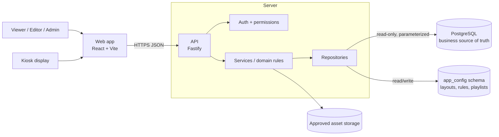
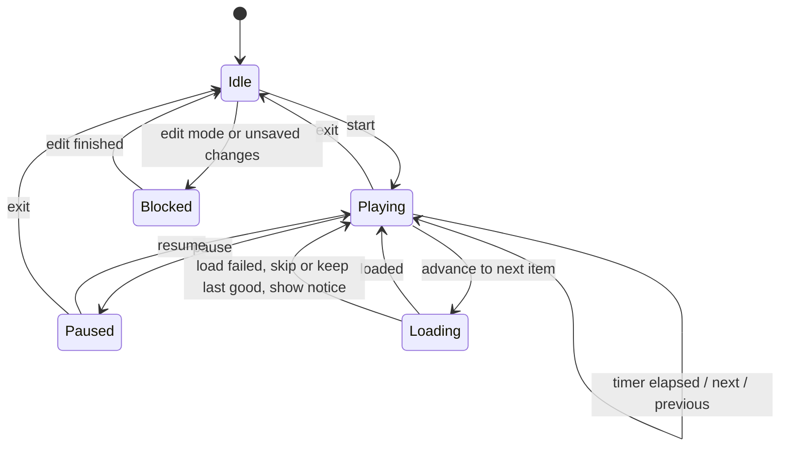
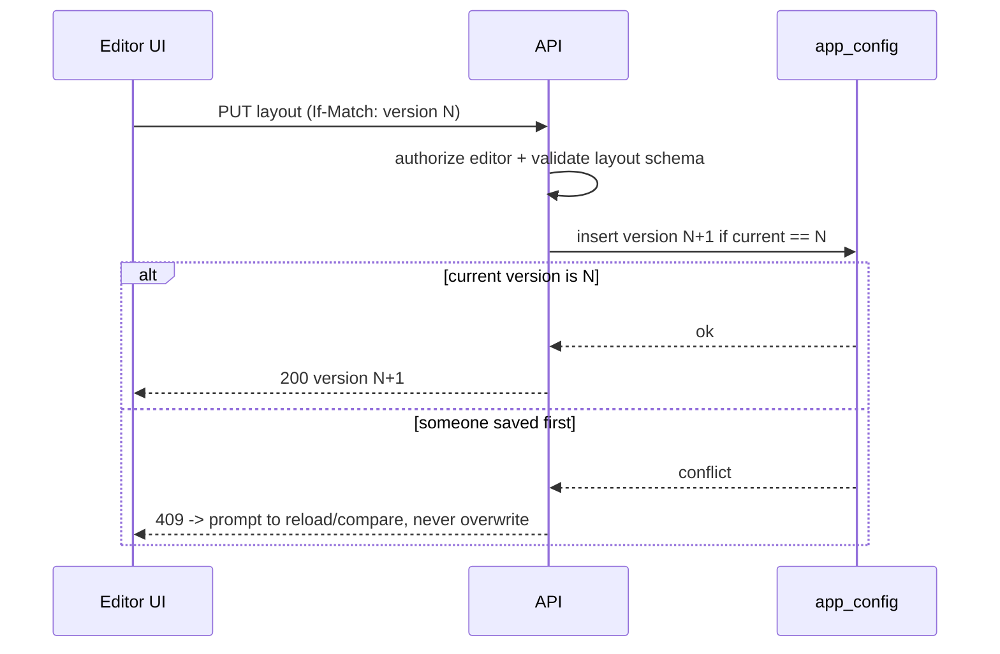

# Architecture

Related: [`PRD.md`](../PRD.md) · [`01-metrics-contract.md`](01-metrics-contract.md) · [`03-data-model.md`](03-data-model.md)

The repository currently contains no application code, so this is a greenfield project. The stack below is the **chosen starting point** (`[I]`); change it only with a recorded decision. Verify current package versions and compatibility at Phase 1 start and pin them in the lockfile; do not copy version numbers into documents.

## 1. System context



Rules: no SQL in the browser; no database credentials in the browser; business tables are read-only for the app; app-owned configuration lives in a separate schema (see `03-data-model.md`).

## 2. Stack

**Frontend:** Node.js current LTS (pinned) · Vite + React + TypeScript (strict) · Tailwind CSS · shadcn/ui on Radix primitives · lucide-react · React Router · TanStack Query (server state, caching, cancellation) · Zustand (client-only state: editor selection, theme UI, rotation) · React Hook Form + Zod · Apache ECharts + echarts-for-react · react-grid-layout behind a local adapter · date-fns (presentation only) · one typed fetch wrapper (ky or native, pick one).

**Backend:** Fastify + TypeScript · `pg` with pooling, timeouts, bounded results · Drizzle ORM + drizzle-kit for app-owned tables only (`app_config`) · Zod at request, response and config boundaries · Pino with redaction · `@fastify/helmet`, `@fastify/cors`, `@fastify/rate-limit` · `@fastify/swagger` + UI for API contracts · least-privilege DB credentials.

**Quality and delivery:** pnpm workspaces · Vitest, Testing Library, user-event, jest-axe · Playwright (Chromium and Firefox) · ESLint, typescript-eslint, Prettier · CI: frozen-lockfile install, lint, typecheck, unit tests, build, E2E.

**Do not add** Redux, a second charting library, overlapping form libraries or a second ORM without a documented need.

## 3. Repository layout (proposed)

```
apps/web/                  React + Vite UI
apps/api/                  Fastify API (routes, services, repositories)
packages/contracts/        Shared DTOs and Zod schemas
packages/dashboard-core/   Metric types, layout schema, threshold evaluation, playlist state machine
packages/config/           Shared tooling config
docs/                      Specification (this folder)
fixtures/                  Clearly labelled MOCK data and golden test cases
```

Modular monolith, not microservices. Route handlers stay thin. Never duplicate working-day or metric formulas across layers.

## 4. Layering

| Layer | Responsibility |
|---|---|
| Route | Authentication/authorization, input parsing, response mapping |
| Service / domain | Business rules, calculations, state-transition validation |
| Repository | Parameterized PostgreSQL access, query-specific aggregation |
| Contract | Request/response DTOs, Zod schemas, stable error shape |
| Configuration | Environment variables, safe runtime defaults |

**Repository interface pattern:** services depend on interfaces (for example `MetricsRepository`). Provide a `MockMetricsRepository` (reads `fixtures/`) now and a `PgMetricsRepository` after the schema is approved. This lets the UI and API be built and tested end to end without guessing the schema.

## 5. Frontend component boundaries

| Component | Responsibility |
|---|---|
| `AppShell` | Layout, sidebar, top bar, route outlet |
| `DashboardRoute` | Loads dashboard metadata, route-level states |
| `GlobalFilterBar` | Date filters and shared filter state |
| `DashboardGrid` | Renders layout from validated widget definitions |
| `WidgetRenderer` | Resolves an allowlisted widget type to a component |
| `KpiCard`, `AchievementBarChart`, `WorkingDayProgress` | Presentational only; receive calculated values and statuses |
| `DashboardEditor` | Drag/resize/add/remove, layout draft state |
| `ThemeProvider` | Light/dark/system tokens and persistence |
| `RotationController` | Playlist state machine and timing, independent of charts |
| `AdminSettings` | Validated forms for rules and playlists |

Domain modules own: metric DTOs and formatting, achievement formulas, role count logic, working-day semantics, threshold evaluation, layout schema/versioning, playlist validation and transitions. Presentation components never query PostgreSQL, contain SQL, infer formulas, or own rotation timers.

## 6. API contract (proposed; none exist yet)

| Method and path | Purpose | Permission |
|---|---|---|
| `GET /api/health` | Liveness/readiness | Public |
| `GET /api/dashboards` | List dashboards | Viewer+ |
| `GET /api/dashboards/:dashboardId` | Dashboard definition + active layout | Viewer+ |
| `GET /api/sales-performance/summary?principalId=&startMonth=&endMonth=&regionId=` | Team totals, role cards | Viewer+ |
| `GET /api/sales-performance/regions?principalId=&startMonth=&endMonth=&regionId=` | Sell IN / Sell Out per region with statuses | Viewer+ |
| `GET /api/calendar/working-day-progress?month=&asOfDate=` | Working-day progress + metadata | Viewer+ |
| `GET /api/sales-performance/growth?principalId=&month=&window=7&metric=sellIn\|sellOut` | Rolling-window growth matrix (`DASH-002`) | Viewer+ |
| `GET /api/sales-performance/active-distributors?principalId=&month=` | Active / total distributors per region | Viewer+ |
| `GET /api/uploads/daily?principalId=&month=&regionId=&branchId=&kind=sales\|stock` | Daily upload grid | Viewer+ |
| `GET/PUT /api/settings/achievement-rules` | Rule set | Admin |
| `GET/POST/PUT /api/playlists` | Playlists | Admin (read: Viewer+) |
| `PUT /api/dashboards/:id/layout` with `If-Match: <version>` | Save layout (optimistic concurrency) | Editor+ |
| Asset list/upload | After storage is approved | Admin |

Every endpoint documents purpose, permissions, filters, response fields, errors, cache policy and freshness. Never return SQL, connection strings, stack traces or internal sensitive identifiers.

**Response envelope for metric endpoints:**

```json
{
  "data": { },
  "period": { "startMonth": "2026-10", "endMonth": "2026-10", "timezone": "TBD" },
  "filtersApplied": { "principalId": "INA", "regionId": null },
  "dataAsOf": "2026-10-21T23:00:00Z",
  "generatedAt": "2026-10-22T05:31:00Z",
  "warnings": [ { "code": "MISSING_TARGET", "scope": "region-002" } ]
}
```

**Error shape (stable):**

```json
{ "error": { "code": "VALIDATION_ERROR", "message": "Start date must not be after end date.", "requestId": "..." } }
```

Validate configuration on read and write; malformed persisted configuration falls back safely and logs an operational warning.

## 7. Rotation state machine

One controller, one timer. Clean up timers/listeners on every transition.



## 8. Layout save flow (concurrency)



## 9. Security, performance, observability

- `SEC-001` `[C]` Permissions enforced on the server; filters and identifiers allowlisted; all queries parameterized.
- `SEC-002` `[C]` Credentials stay server-side; metric queries use a read-only least-privilege account.
- `SEC-003` `[P]` Restrictive CORS, security headers, rate limits, request timeouts, safe errors, redacted logs.
- `SEC-004` `[P]` Validate image uploads (type, size, dimensions); no unsafe external URLs, path traversal or arbitrary HTML.
- `SEC-005` `[O]` Authentication provider and kiosk credential model (DEC-007, DEC-012).
- `OPS-001` `[P]` Aim for LCP <= 2.5 s; set API latency targets once data volume and hosting are known.
- `OPS-002` `[P]` Fetch active dashboard data first; prefetch only the next rotation item when safe.
- `OPS-003` `[P]` Structured logs with request IDs, health endpoint, error tracking, query timing.
