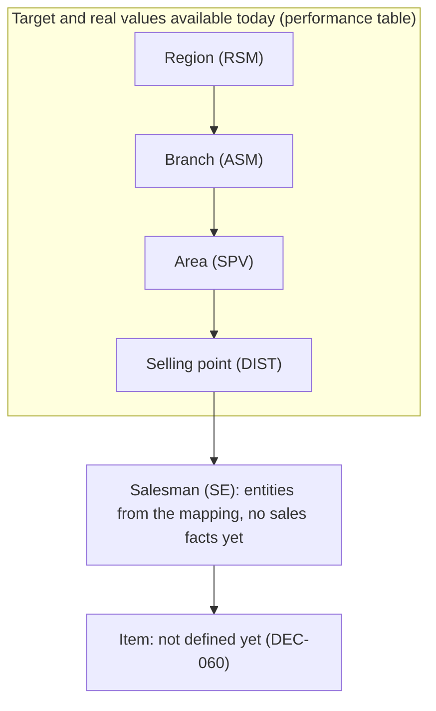

# Dashboard Catalog

The four reference dashboards (Tableau sheets) and what each must show. Cross-cutting rules come first; then one section per dashboard. Calculation detail lives in [`01-metrics-contract.md`](01-metrics-contract.md); source tables in [`03-data-model.md`](03-data-model.md); screenshots in [`reference/`](reference/README.md).

Tags: `[C]` owner-confirmed, `[R]` reference-observed (screenshot or Tableau workbook), `[P]` proposed, `[O]` open.

## 1. Cross-cutting requirements (all dashboards)

- `DASH-001` `[C]` **Tooltip on every chart element.** Hovering (and keyboard-focusing) a bar, point, card or cell shows at least **target value**, **real (actual) value** and **achievement %**. Growth charts also show last-year value and growth % (see 3). The Daily Upload grid shows date, distributor and status (`[O]`: confirm no target/real there).
- `DASH-002` `[C]` **Rolling 7-month window** on the Growth dashboards: always the selected month plus the 6 months before it. When the calendar moves to the next month, the window moves with it (for example selected Oct-26 shows Apr to Oct; Nov-26 shows May to Nov). The default selected month is the current business month.
- `DASH-003` `[R]` **Period selection is by month.** Start_Date and End_Date are month pickers (shown as "Oct-26"), not day pickers.
- `DASH-004` `[C]` **Principal is chosen in the web with buttons ASW and INA.** Both are in release 1. Which principals a user can pick is set by admin permissions (see `DASH-008`); a user with one allowed principal gets it preselected, and only users with full access can switch between both. Tables per principal come from the principal registry (`03-data-model.md` 2.6), not from code (DEC-022, DEC-035).
- `DASH-009` `[C]` Where a figure comes from a manual upload (active distributors from `distaktif`), the dashboard labels the source and shows the latest month present, and links to related data findings (`FIND-003`, `FIND-004`).
- `DASH-010` `[C]` **Freshness.** Data is monthly and loaded by an ETL (about 3 hours, nightly today). The current month is month-to-date as of the last completed refresh; every dashboard shows "data as of". Near-real-time refresh is planned, so refresh timing is configuration, not code (`02-architecture.md` section 13).
- `DASH-011` `[C]` **Auto-refresh.** When a data refresh finishes, open dashboards, kiosk/playlist displays and AI results update automatically (no manual reload, no flicker). The trigger is the end of an ETL run, not individual row changes (`OPS-004` to `OPS-010`, DEC-048).
- `DASH-008` `[C]` **Configurable access.** Principal, region and other filters show only the values the signed-in user is allowed; some users have one region, some several, some all. Roles, capabilities and data scopes are managed by admins and stored as data, never hard-coded. Every number on every dashboard is computed within the user's scope (`02-architecture.md` section 10).
- `DASH-005` `[R]` Shared header on dashboards 1 to 3: logo, title, Start_Date / End_Date, team counts (RSM, ASM, SPV, SE), working-day progress ring, display date.
- `DASH-006` `[R]` Visual style of the Tableau dashboards: dark navy gradient background, orange outlined cards and headings, white values. This becomes an optional brand preset on top of the light/dark tokens (see `04-ui-ux-spec.md`).
- `DASH-007` `[P]` Number formatting: percentages follow the approved precision (cards show 2 decimals, bars show whole percent); target/real values use thousands separators and the approved unit/currency (DEC-030).

## 2. Dashboard 1: Sales Performance (`sheet1.png`)

**Purpose:** current-month performance versus target and versus working-day pace, by region, with role-level achievement counts.

| Zone | Content | Source of truth |
|---|---|---|
| Header | Title, Start_Date / End_Date (month), "JUMLAH TEAM": RSM, ASM, SPV, SE totals, working-day ring, display date | `01` sections 5.1, 5.2, 5.7, 5.8 |
| Role cards | RSM (5), ASM (19), SPV (75), DIST (144). Each: headcount, IN % and count, OUT % and count | `01` section 5.3 |
| Region chart | 5 region columns (INA JAWA 1, JAWA 2, PULAU 1, SUMATERA 1, SUMATERA 2). Paired bars Sell IN / Sell Out, whole-percent labels, y-axis 0 to 100% in 10% steps, horizontal reference lines at 25, 50, 75 and 100% | `01` sections 5.4 to 5.6 |

- `PERF-001` `[R]` Bar color follows the confirmed color rule (RULE-001 to RULE-005), using the working-day ring value as the pace. Example in the screenshot: working-day 66.67%, INA PULAU 1 Sell IN 77% is green; 43%, 50%, 48%, 35% are red; every Sell Out bar is red.
- `PERF-002` `[C]` Card counts use the same rule as the bars: an entity counts as achieved when achievement >= working-day progress. In the screenshot only INA PULAU 1 Sell IN (77% against 66.67%) qualifies, so RSM IN is 1 of 5 = 20%. The count is live: if working-day progress later exceeds an entity's achievement, it stops counting (RSM IN becomes 0) (DEC-021).
- `PERF-003` `[C]` Tooltip on bars: target, real, achievement %. Card tooltip: entities counted, headcount, % (`[O]`: list the names that achieved, as Tableau's "#List ... Capai" sheets suggest).
- `PERF-004` `[R]` Values above 100% must render (axis extends); regions come from data, not hard-coded.
- `PERF-005` `[O]` Role cards for DIST show IN/OUT without labels in the image; confirm DIST means selling point (distributor) and that SE appears only in the header (DEC-002). The DIST card total (144, a distinct count from the database) can differ from the sum of active-distributor totals on sheet 2 (120, a manual Excel upload in `distaktif`); both are shown as stored and the gap is a data finding (DEC-034, `08-data-findings.md`).

## 3. Dashboards 2 and 3: Growth Sell In and Growth Sell Out (`sheet2`, `sheet3`)

**Purpose:** compare each of the last 7 months this year against the same month last year, per region, with the growth trend.

Layout observed:
- **Top strip:** Sell In shows one card per region with "active / total (percent)" using `distaktif`: `Total Aktif / TOTAL DIST` (for example 30 / 31 = 97%; confirmed, DEC-024). Sell Out shows the RSM/ASM/SPV/DIST role cards as in dashboard 1 (observed in the screenshot).
- **Matrix:** one row per region (5), one column per month (7: Apr to Oct for Oct-26). Month number on top, years 2025 and 2026 under each pair.
- **Each cell:** two bars (last year same month on the left, this year on the right), a connecting growth line across months, and a label above each closed month showing growth with arrow: up (green) or down (white).
- Current (in-progress) month shows bars but no growth label.

Requirements:
- `GROW-001` `[C]` Window = `DASH-002` (selected month and 6 prior, with the same months of the previous year).
- `GROW-002` `[R]` Growth % for month m = (real in m this year / real in m last year) - 1, Sell IN uses real Sell In, Sell Out uses real Sell Out. Zero or missing last-year value shows "n/a", never infinity (DEC-025).
- `GROW-003` `[R]` Growth label shown only for closed months; the current month shows none (matches `Filter until closing month`, DEC-025).
- `GROW-004` `[C]` Tooltip per bar: **target, real, achievement %** for that region and month and year. Tooltip on the growth point/label: this-year real, last-year real, growth %.
- `GROW-005` `[R]` Bar colors, observed: this-year bars are green or yellow, last-year bars are green or red. Tableau logic for this-year bars: green when achievement >= 100% or real >= previous month's real, otherwise yellow. Last-year bar logic is not fully recoverable from the workbook (DEC-023). Use the observed behavior as `[P]` until confirmed.
- `GROW-006` `[R]` Year boundary: windows that cross a year (for example Mar-27 shows Sep-26 to Mar-27) order months chronologically, with the year shown per bar.
- `GROW-007` `[O]` Shared y-axis across region rows or independent per row (the Sumatera 1 Sell Out row looks tiny against others in the screenshot).
- `GROW-009` `[C]` Region cards (Sell In) show `active / total (percent)` from `distaktif`, rounded to a whole percent; they respect the user's region scope.
- `GROW-008` `[P]` Accessible alternative: a table per region (month, last-year real, this-year real, target, achievement %, growth %).

## 4. Dashboard 4: Daily Upload (`sheet 4-Daily Upload.png`)

**Purpose:** show, per distributor, which days of the selected month a daily upload to Eskalink happened. Title in the image: "LOG UPLOAD SLO DISTRIBUTOR TO ESKALINK".

- `UPLD-001` `[R]` Filters: PERIODE (month, default current), REGIONNAME, BRANCHNAME (each with "All").
- `UPLD-002` `[R]` Grid: one row per distributor (selling point with city, for example "PT. ... - SERANG"); one column per day of the month. Cell is green "Upload" or orange "Not Upload"; future days are blank. A bold number at the row start equals the count of upload days (6 in the example, matching 6 green cells).
- `UPLD-003` `[R]` Status rule (Tableau): a day is Upload when a row exists with `Updated = 1` for that city and date, otherwise Not Upload.
- `UPLD-004` `[R]` The workbook has a parallel "stock upload" variant (`mt_daily_updatestockina`); `[O]` whether it is a second view/toggle of this dashboard (DEC-026).
- `UPLD-005` `[O]` Weekends and holidays are shown as Not Upload in the screenshot (for example Oct 3 and 4); confirm whether they should be neutral instead.
- `UPLD-006` `[O]` Rows labelled VACANT or without data are shown empty; define handling.
- `UPLD-007` `[P]` Status must not rely on color alone (text/icon, A11Y); tooltip shows date, distributor, status.

## 5. Dashboard 5: Data Findings (new, owner-requested)

A separate sheet listing anomalies and findings that need validation, for example the difference between the distinct DIST count (144) and the manually uploaded active-distributor total (120). Full spec: [`08-data-findings.md`](08-data-findings.md). Requirement IDs `FIND-001` to `FIND-006`.

## 6. Dashboard 6: Sales Detail (pivot-style table, owner-requested)

**Purpose:** a detail table where the user chooses the header names (dimensions) and the fact values (measures) and sees totals. The workbook's older `DetailPerAreaSellIN` and `DetailPerAreaSellOut` sheets (separate Sell In and Sell Out detail by area) are replaced by this single, flexible view.

Example from the owner (the columns and values are **only an example, not a fixed layout**: the user chooses which columns to show):

| Region | Branch | SPV | Distributor | Target | Real Sell IN | Real Sell OUT |
|---|---|---|---|---|---|---|
| INA JAWA 1 | JAKARTA | SPV JAKARTA | ABC | 5000 | 2000 | 3000 |
| **Grand total** | | | | 5000 | 2000 | 3000 |

- `PIVOT-001` `[C]` A detail table with dimension columns, fact columns and a **grand total** row.
- `PIVOT-002` `[C]` A **period range filter**: the user chooses a start and an end period from the list of available periods (months). Facts are summed over the range.
- `PIVOT-003` `[C]` The user **chooses which dimension columns to show**, in any combination. The dimensions form a **hierarchy** (see below): Region (RSM), Branch (ASM), SPV (area), Distributor (selling point), then Salesman (SE) and Item where the data exists. `[P]` City (`KOTA`) as a flat, non-hierarchical column.
- `PIVOT-004` `[C]` The user **chooses which fact columns to show** from every available measure: Target Sell IN, Target Sell OUT, Real Sell IN, Real Sell OUT. `[P]` derived columns: achievement % for Sell IN and Sell OUT, shortfall to target, pace gap (`01` section 9). Nothing is fixed to the owner's example (DEC-052).
- `PIVOT-005` `[C]` **Grand total** at the bottom. `[P]` Subtotals at each grouping level with expand and collapse. Totals are calculated **by the server from the underlying values**, never by adding rounded numbers on screen. Percent columns are `SUM(real) / SUM(target)` at every level, not an average of row percentages.
- `PIVOT-006` `[P]` Sorting, a filter on each dimension (only values the user may see), search, column chooser, frozen header, and server-side paging or virtual scrolling for large result sets.
- `PIVOT-007` `[P]` Percent columns use the bar color rule (RULE-001 to RULE-005) with a text or icon cue (`A11Y`).
- `PIVOT-008` `[P]` Export to Excel and CSV (MGMT-007).
- `PIVOT-009` `[P]` Saved views: dimensions, facts, order, period and filters, per user (MGMT-009).
- `PIVOT-010` `[C]` Access scope applies: the user sees only allowed principals and regions, and the grand total says it is "within your access".
- `PIVOT-011` `[P]` **Governed query, no free SQL.** Dimensions and measures come from an allowlisted field catalog (`03-data-model.md` section 2.8). The server builds a fixed, parameterized aggregation (grouping with roll-up for totals) over the approved performance table. Limits: at most 4 dimensions, a row cap with a clear "refine your filters" message, query timeout.
- `PIVOT-012` `[P]` Drill-down links: from any Sales Performance or Executive Summary item to this table pre-filtered (MGMT-004).
- `PIVOT-013` `[P]` The owner's example row becomes the first golden fixture (labelled mock), with Target Sell IN and Target Sell OUT both 5000: Sell IN 2000 gives 40% and Sell OUT 3000 gives 60%.

### 6.1 Hierarchy and drill-down

The dimension columns come from the organisation hierarchy (the mapping view). The user can **drill down from the top level to the deepest level that exists**, down to SE, and to item if an item level exists.

- `PIVOT-014` `[C]` **Drill down by hierarchy.** After the user has chosen the columns, each row of a hierarchical dimension can be expanded to the next level (Region > Branch > SPV > Distributor > SE > Item) for as long as a deeper level exists. Collapsing returns to the parent.
- `PIVOT-015` `[P]` **Two modes** over the same chosen columns: *Flat* (chosen dimension columns side by side, as in the owner's example, with subtotals) and *Drill* (a tree: start at any level, expand rows level by level, with a breadcrumb). The chosen fact columns stay while drilling.
- `PIVOT-016` `[P]` Every node shows the chosen measures aggregated for its whole subtree, so a parent equals the sum of its children (percent columns are recalculated as `SUM(real) / SUM(target)`, never summed). Facts that cannot be placed on a lower level appear under an **Unassigned** node so totals still reconcile.
- `PIVOT-017` `[C]` **Levels without data are never filled in.** Region to Distributor have target and real values today. SE and Item levels show only what the source holds: SE rows from the mapping (names, counts) with the measures marked "not available at this level", until a source with SE-level or item-level facts is supplied (DEC-059, DEC-060). Zero is never shown in place of "not available".
- `PIVOT-018` `[P]` Children load on demand (one level at a time, with the same period, filters, scope and measures), with a row cap and a "refine your filters" message; an "expand to level N" control is bounded by the same cap.
- `PIVOT-019` `[P]` **Admin can cap the deepest level a role may see** (for example, the CEO to Distributor, an SPV to SE). Scope also applies at every level: a user only expands into values they may see. The cap is a role setting, not code (`02` section 10).
- `PIVOT-020` `[P]` Accessible tree-grid: keyboard expand/collapse, announced level and state, focus kept on the same row after expanding.
- `PIVOT-021` `[P]` The hierarchy is defined by a registry (`03-data-model.md` section 2.8), not hard-coded, so adding a level later (for example item) needs a registry entry and a source, not a redesign.

## 7. AI Chat (right panel)

An icon in the right panel opens a chat that answers questions from the data and can show pop-up charts, cards, lines and bars. Full spec: [`07-ai-chat.md`](07-ai-chat.md). Requirement IDs `AI-001` to `AI-047`.

## 8. Navigation and playlist

All four dashboards are sidebar entries and can be playlist items (default 10 s). Dashboards 1 to 3 share the month filter; DEC-010 decides whether it persists across rotation.
