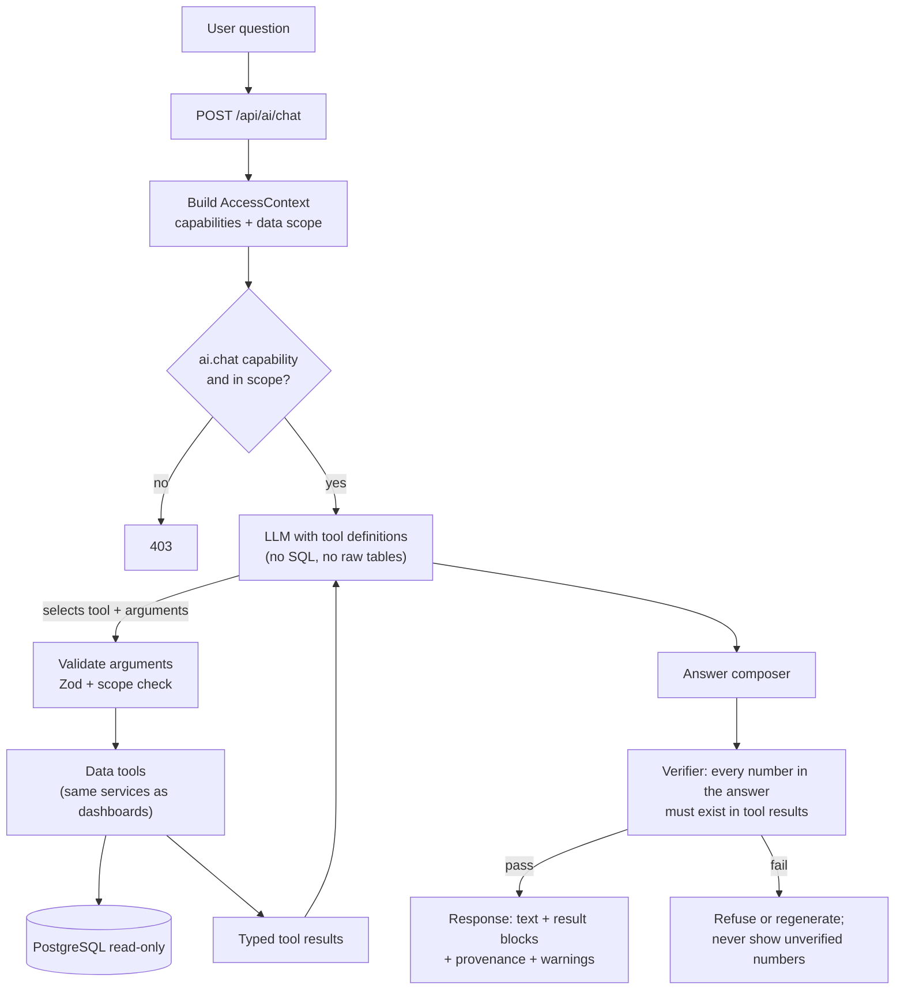
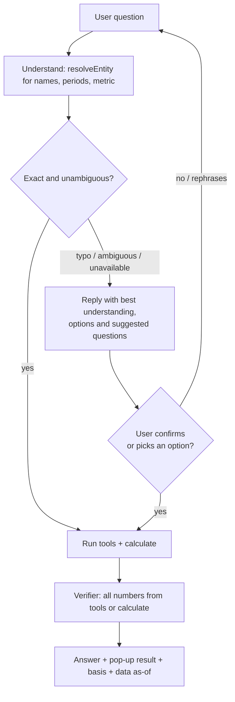
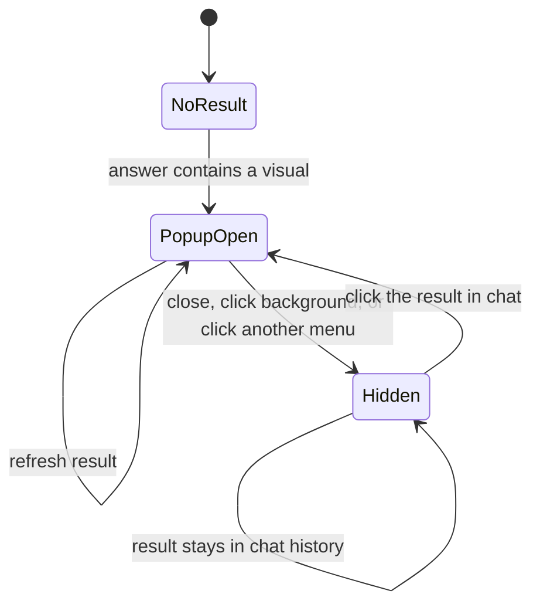
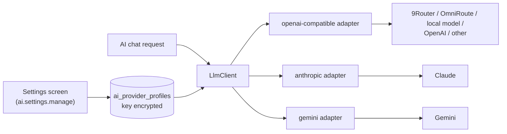

# AI Data Chat

Related: [`PRD.md`](../PRD.md) · [`02-architecture.md`](02-architecture.md) · [`01-metrics-contract.md`](01-metrics-contract.md) · [`08-data-findings.md`](08-data-findings.md)

Tags: `[C]` owner-confirmed, `[P]` proposed, `[O]` open.

## 1. Owner requirements

- `AI-001` `[C]` An **AI Chat icon in the right panel**. Clicking it opens a chat box.
- `AI-002` `[C]` Users ask about **data already in the database**; the AI answers from that data.
- `AI-003` `[C]` The AI **never answers from outside the data, never guesses, never assumes, never hallucinates.**
- `AI-004` `[C]` Answers can come as a **pop-up chart, card, line chart or bar chart**, depending on the request, or the best result the AI can produce.
- `AI-005` `[C]` The pop-up **hides** when the user finishes viewing, clicks another menu, or clicks the background. The **result is not lost**: it stays in the chat and can be reopened by clicking it.
- `AI-006` `[C]` Example request: "give me growth sell in from month to date vs last month to date for region INA JAWA". Data is **monthly**, refreshed every night; the current month is therefore always month-to-date as of the last refresh. The AI tells the user what exists (only monthly periods; no "last month to date"), asks about the ambiguous region, and answers after the user confirms. See section 8.
- `AI-007` `[C]` If the question looks wrong or contains a typo, the AI **asks to confirm** its understanding and may **suggest** better questions. When the user confirms, it gives the result.
- `AI-008` `[C]` The AI may do **logical calculation** (sums, differences, percentages, ratios, averages, ranking) on data already available in the dashboards. It must **not query the database freely or use any table outside the existing, approved ones**.
- `AI-009` `[C]` Chat history is **cleaned after 60 days**.

## 2. Design principle: the AI chooses tools, it does not write SQL

The model never receives database credentials, never writes SQL, never queries tables on its own, and never types the numbers you see. It selects from a fixed catalog of **read-only data tools** that call the same services, formulas and access checks as the dashboards. Numbers come from tool results; the model only decides *which tool to call*, *how to phrase the answer*, and *which visual type fits*. This is what makes "no assumptions, no hallucination" enforceable rather than a hope.



## 3. Data tool catalog (initial, all read-only and scope-enforced)

Each tool lives beside the dashboard service it reuses (parity guaranteed by construction). New dashboards add their tools.

| Tool | Returns | Reuses |
|---|---|---|
| `listPrincipals`, `listRegions`, `listAvailablePeriods` | Values the user may use (resolves names like "INA JAWA 1") | Access scope + data |
| `getAchievement(principal, regions[], period, metric)` | Target, real, achievement %, status | METRIC-005/006, RULE |
| `getGrowth(principal, regions[], metric, period, compareTo)` | This period, comparison period, growth % | METRIC-015 |
| `getRoleCounts(principal, scope, period)` | Role totals, IN/OUT achieved counts and % | METRIC-002..004 |
| `getTeamTotals(principal, scope, period)` | RSM, ASM, SPV, SE totals | METRIC-002 |
| `getActiveDistributors(principal, regions[], period)` | Active, total, % | METRIC-016 |
| `getWorkingDayProgress(period)` | Elapsed, total, % | METRIC-008 |
| `getUploadStatus(principal, filters, month)` | Upload days per distributor | METRIC-017 |
| `getDataFindings(principal, scope)` | Open anomalies relevant to the answer | `08-data-findings.md` |
| `resolveEntity(kind, text)` | Deterministic fuzzy match of a typed name (region, metric, period) to allowed values, with candidates and similarity | Allowed values in scope |
| `calculate(operation, inputs)` | Exact arithmetic on **values returned by other tools**: sum, difference, ratio, percent change, average, min, max, rank, share of total. Returns the result and the formula | Deterministic code, not the model |

**All data comes from the dashboards' own services**, which run fixed, parameterized queries on the approved tables only (`03-data-model.md` section 4). The AI cannot create a new query, add a table, or reach data a dashboard does not use. The model never does arithmetic itself: the `calculate` tool does, so results are exact and checkable. If no tool can answer the question, the AI says so. **A capability that does not exist as a tool is not improvised.** Day-level or custom-range tools exist only if the verified data grain supports them (section 8, example B).

## 4. Result blocks and visual spec

The AI returns **structured JSON**, rendered by the app's existing chart components. It never returns HTML, script or SVG.

Allowed types: `card`, `bar`, `line`, `table`. The AI picks the best fit (for example growth over months: `line`; comparing regions: `bar`; one figure: `card`; many rows: `table`), unless the user names a type. If the requested type cannot show the data truthfully (a pie of growth, for instance), the AI says why and offers the closest allowed type.

```json
{
  "resultId": "res-0001",
  "type": "bar",
  "title": "Sell In growth, placeholder",
  "principalId": "INA",
  "filters": { "regionIds": ["TBD-region-key"] },
  "period": { "from": "2026-09", "compareTo": "2025-09" },
  "series": [
    { "name": "2025-09", "points": [ { "x": "TBD-region", "target": 0, "actual": 0, "pct": 0.0 } ] },
    { "name": "2026-09", "points": [ { "x": "TBD-region", "target": 0, "actual": 0, "pct": 0.0 } ] }
  ],
  "growthPct": 0.0,
  "provenance": { "tools": ["getGrowth"], "metricRefs": ["METRIC-015"], "dataAsOf": "TBD", "generatedAt": "TBD" },
  "warnings": [ { "code": "DATA_FINDING", "findingId": "TBD" } ]
}
```

Values above are placeholders. The same tooltip contract as dashboards applies (`DASH-001`: target, real, %).

## 5. Behavior rules

- `AI-010` `[C]` Every figure in an answer comes from a tool result or a `calculate` result built from tool results; a **verifier** rejects any number that is in neither. No estimates, forecasts, projections or "typical" values.
- `AI-011` `[C]` No causes or opinions: the AI shows what the data says, not why. "Why did it drop?" returns the relevant data and states that causes are not in the data.
- `AI-012` `[C]` **Ambiguity and typos are confirmed, not assumed** (see `AI-024`). If a name or period matches more than one value ("INA JAWA" matches INA JAWA 1 and INA JAWA 2) the AI asks the user to choose (buttons), or, only when the user asked for "all", shows each separately and labels them.
- `AI-013` `[C]` **Unavailable data is stated plainly**: which metric, which period, why (not in the database, not in the user's access, grain too coarse). Nothing is filled in.
- `AI-014` `[C]` Out-of-scope data is treated as not available to the user. The AI does not reveal that other principals, regions or users' data exist.
- `AI-015` `[C]` Questions that are not about the data in the system (general knowledge, chit-chat, advice) get a short refusal explaining that the assistant answers from the system's data only.
- `AI-016` `[C]` Every answer shows its basis: metric and formula reference, principal, region, period, filters, and data as-of time. When a relevant open data finding exists (for example distributor totals from a manual upload that looks stale), the answer shows that warning (`08-data-findings.md`).
- `AI-017` `[P]` The AI replies in the user's language (Bahasa Indonesia or English) and uses the same labels as the dashboards (DEC-042).
- `AI-018` `[C]` Read-only. No tool writes, changes configuration, or sends data elsewhere.
- `AI-019` `[P]` Limits: per-user rate limit, maximum tool calls per question, maximum rows per result, request timeout, and a spend cap; limits show a clear message.
- `AI-020` `[P]` Treat all database text (names, notes) as untrusted data, never as instructions (prompt-injection defense).

- `AI-024` `[C]` **Confirm-then-answer flow.** When the question has a typo, an unknown or ambiguous name, a period that does not exist, or asks for something the data cannot give, the AI replies with its best understanding and options ("Did you mean Sell IN for INA JAWA 1?") as buttons, and may suggest related questions. It runs the tools and shows the result only after the user confirms. An exact, unambiguous question is answered directly without a confirmation step. Name matching is done by the deterministic `resolveEntity` tool, not by the model's guess.
- `AI-025` `[C]` Any calculation is disclosed: the answer shows the inputs and the formula (for example "Total Sell In = region 1 + region 2 + ..."). Calculations only use values already shown or available in the dashboards.
- `AI-026` `[C]` The current month is **month-to-date as of the last completed data refresh**. Answers label it so and show the refresh time. A comparison of the in-progress month with a full month is labelled "not like-for-like". The AI does not scale, pace-adjust or project figures unless the user asks for a defined calculation on existing values.
- `AI-027` `[P]` Data is loaded by an ETL (about 3 hours, nightly today); near-real-time is planned. Freshness comes from `dataAsOf` (the finish time of the last completed run), so the AI's wording follows whatever the refresh cadence is (`02-architecture.md` section 13).



## 6. Access control

- `AI-021` `[C]` The feature is a capability (`ai.chat.use`) that admins can switch on or off per role. Users without it do not see the icon.
- `AI-022` `[C]` Tools run with the asking user's **AccessContext**, so the AI can see exactly what the user can see and nothing more (principal, region, other scopes). A tool call outside scope returns "not available".
- `AI-023` `[P]` Admin can limit which tools a role may use (for example, no `getUploadStatus`).

## 7. UI behavior

- Icon in the right panel; click toggles the chat box. Chat history is listed per user with timestamps.
- A visual result opens as a **pop-up** (chart, card, line or bar) above the page.
- The pop-up hides when the user finishes (close button), clicks **another menu**, or clicks the **background**. Hiding never deletes the result.
- Each result stays in the chat as a clickable item (thumbnail + title + period). Clicking it **reopens the same pop-up**.
- Reopened results show their **as-of time**; a "Refresh" action re-runs the tool under the user's current access and shows the new as-of time, keeping the old one in history.



- Keyboard: icon and results are reachable and operable by keyboard; the pop-up traps focus while open and restores it on close; chart alternative table available (`A11Y-002`).
- The pop-up never covers the chat input in a way that blocks asking a follow-up on narrow screens.

## 8. Worked examples (expected behavior)

**A. Ambiguous region.** "growth sell in for INA JAWA": INA JAWA 1 and INA JAWA 2 both match. The AI asks "Which region: INA JAWA 1, INA JAWA 2, or both?" with buttons and does not pick one.

**B. The owner's example.** "growth sell in from month to date vs last month to date for region INA JAWA".
1. The region is ambiguous (see A).
2. Data is monthly and loaded by the ETL (nightly today). The AI says: the data has monthly periods only. October 2026 is month-to-date as of the last refresh (shows the time); September 2026 is a full month, so "last month to date" does not exist. It offers options: October 2026 (month to date) versus September 2026, or versus October 2025, noting they are not like-for-like.
3. The user picks (or confirms), and the AI shows the result as a pop-up bar or line chart with target, real, % and the growth, plus the as-of time.

**C. Direct answer.** "show Sell IN growth for INA JAWA 1, September 2026 versus September 2025 as a bar chart": unambiguous and exact, so the AI calls `getGrowth`, shows the pop-up bar chart with target, real, % for each year and the growth, and a note with period and data as-of time. No confirmation step is needed.

**D. Typo.** "sel in INA JAWA1 sept": the AI replies "Did you mean Sell IN, INA JAWA 1, September 2026?" with a Confirm button and alternatives. After Confirm it answers as in C.

**E. Logical calculation.** "total Sell In of all regions in October": the AI gets each region's real and target from the tools, uses `calculate` to sum them and divide, and shows "Total real = r1 + r2 + ..., achievement = total real / total target" with the numbers. "Which region has the highest growth": ranking via `calculate` over `getGrowth` results.

**F. Out of scope.** A user limited to INA asks about ASW: "No data is available for your access." No further detail.

**G. Not data.** "Why are sales down?" or "What will next month be?": the AI shows the relevant numbers if a tool fits and states that causes and forecasts are not in the data. It offers a data question it can answer.

**H. Outside the existing data.** "Show sales by product": no such table or tool exists in the approved data, so the AI says it is not available and lists what it can show (regions, roles, active distributors, uploads, growth).

## 9. AI provider settings (configurable by admin)

**Owner decision `[C]` (DEC-047):** the AI provider is **a setting, not a code choice**. An admin can pick the provider and model, enter and save the API key, and switch at any time. Supported choices include 9Router, OmniRoute, a local model server, Claude, Gemini, OpenAI (including Codex models) and any other OpenAI-compatible endpoint.

### 9.1 Settings screen (`ai.settings.manage`)

- `AI-037` `[C]` **Provider profiles.** The admin creates one or more profiles; each has: name, **provider type**, base address (where needed), **model**, **API key**, enabled flag. One profile is **active**; switching the active profile takes effect for new questions without a deploy.
- `AI-038` `[C]` **Provider types** (adapters): `openai-compatible` (covers 9Router, OmniRoute, local servers such as Ollama, llama.cpp or vLLM, OpenAI, and Gemini through its OpenAI-compatible endpoint), `anthropic` (Claude, native API with tool use), `gemini` (native, optional). Adding a new type means adding one adapter; the rest of the chat does not change.
- `AI-039` `[C]` **API key handling.** The key is entered in the settings screen and saved server-side, **encrypted at rest**. It is **write-only in the UI** (only the last 4 characters are shown), never sent back to the browser, never logged, and can be replaced or deleted. Only `ai.settings.manage` can set it. The encryption master key lives outside the database (server secret, held by the technical administrator; DEC-049). Local servers that need no key can leave it empty.
- `AI-040` `[C]` **Model selection.** The admin types a model id or picks from the provider's model list when the provider supports listing. Model names are never hard-coded in the app.
- `AI-041` `[P]` **Test button.** "Test connection" checks reachability and authentication; "Test tool calling" runs a small fixed set of questions (one per tool and one refusal) and shows pass/fail. The profile shows its status (`untested`, `passed`, `failed`) and last test time. By default a profile must pass the tool-calling test before it can be activated; an admin can override with a recorded warning.
- `AI-042` `[P]` **Data-sharing notice.** Selecting a provider that is not local shows which data leaves the server (aggregated results the user is allowed to see, never raw tables or credentials) and requires the admin to acknowledge it. The acknowledgement is audited. (DEC-050)
- `AI-043` `[P]` **Global AI settings:** AI on/off, temperature (default lowest), maximum tool calls per question, rate limits per user, and chat retention (default 60 days, `AI-035`).
- `AI-044` `[C]` Every change (profile created, key replaced, active profile switched, test run, settings changed) is **audited** without the key value.
- `AI-045` `[P]` **Gateway warnings.** The app cannot control a gateway's internal behavior. For gateway types (9Router, OmniRoute) the screen shows a checklist: turn off fallback to other models, turn off token or tool-result compression, use a fixed model or combo. The app also **records the model each answer actually used** and raises a warning in the audit log when it differs from the configured model (detects silent fallback).
- `AI-046` `[P]` **Safety does not depend on the provider.** The verifier, the tool catalog, scope enforcement and the no-free-query rule apply to every provider. A weaker model may refuse or fail more often, but cannot show a number that is not in the tool results.
- `AI-047` `[O]` An optional secondary profile used only when the active one is down, clearly labelled in answers and audit (off by default).



### 9.2 What the three tools you mentioned are (checked online)

- **9Router and OmniRoute** are self-hosted AI gateways with an OpenAI-compatible endpoint. They route to many providers, can fall back automatically (including free tiers), and can compress tool results. They are built mainly for coding tools.
- **OpenCode** is an open-source coding agent with an HTTP server, not a model gateway. It is a poor fit as a chat backend (it is an agent with file and command tools), so it is **not offered as a provider type**; it remains a developer tool.

### 9.3 Privacy and retention

- `AI-035` `[C]` Chat history is **deleted after 60 days** (sessions, messages, results, tool-call content) by a daily job; the UI says when a result expires. Non-content usage counters (requests, latency, model) may be kept for operations.
- `AI-036` `[P]` A local gateway is not necessarily a local model. If the profile routes to cloud providers, aggregated tool results leave the server and that provider's data terms apply (free tiers and consumer subscriptions can differ from paid API terms). The admin decides which providers to use; a fully local model keeps data on the server.
- Only aggregated results the user is allowed to see are sent to any model.

## 10. Testing and evaluation

- **Golden Q&A set:** each question lists expected tool, arguments and numbers; numbers must equal the dashboard service output (parity test, `AI-010`).
- **Calculation tests:** sums, differences, percent changes, averages and rankings equal independent calculations; formulas are shown.
- **Verifier tests:** inject a model answer with a number that is in no tool or calculate result; it must be rejected.
- **Typo and ambiguity tests:** "sel in", "INA JAWA", "JAWA1", missing period, unknown region: the AI asks and answers only after confirmation.
- **Grain and freshness tests:** "month to date" and "last month to date" requests produce the monthly-data explanation and the as-of time, never an invented figure.
- **Boundary tests:** requests for tables or breakdowns that do not exist ("by product"), SQL, credentials, other users' chats: refused.
- **Scope tests:** users with different principals/regions; out-of-scope requests; cache isolation.
- **Adversarial tests:** prompt injection inside database text; forecasting and "why" questions.
- **Provider settings tests:** key is never returned by any API or log; replace and delete work; activation requires a passed tool-calling test (override is audited); switching provider applies to the next question; model-mismatch warning is raised; behavior when the provider is down (clear message, no partial numbers).
- **Adapter tests:** the same golden Q&A set passes through each adapter with a mock provider.
- **Retention test:** items older than 60 days are removed; reopening an expired result says so.
- **UI tests:** pop-up opens, hides on close/background/other menu, result stays in chat, reopens, refresh keeps history, keyboard and screen-reader behavior.

## 11. Open decisions

DEC-040 (who may read chats), DEC-049 (where the encryption master key lives), DEC-050 (data-sharing acknowledgement). See `decisions.md`.
