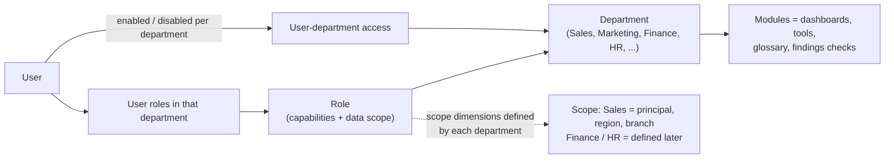

# Departments and Modules (platform for future dashboards)

Related: [`PRD.md`](../PRD.md) · [`02-architecture.md`](02-architecture.md) · [`03-data-model.md`](03-data-model.md) · [`04-ui-ux-spec.md`](04-ui-ux-spec.md) · [`06-dashboard-catalog.md`](06-dashboard-catalog.md)

Tags: `[C]` owner-confirmed, `[P]` proposed, `[O]` open.

## 1. Owner direction

- `DEPT-001` `[C]` Today the product is the **Sales** dashboards. **Marketing, Finance, HR and any other department** will be added later, each with its own dashboards.
- `DEPT-002` `[C]` The UI and the access model must **plan for them now**, even though they do not exist yet.
- `DEPT-003` `[C]` A **department role can be added to every user** and each department can be **enabled or disabled per user**.
- `DEPT-004` `[C]` The **department table does not exist yet**, so the app creates and manages its own department list (admin-managed), instead of reading one from the business database.
- `DEPT-005` `[C]` Marketing will own the **product (item)** dashboards, with the product name and `pcode` (product code). Product data is not part of the Sales release (DEC-060).

## 2. Model



- A **department** is admin-managed data: id, name, order, icon, status (`planned`, `active`, `disabled`), default landing.
- A **module** is a set of dashboards (and AI tools, glossary entries, findings checks) that belongs to one department. Existing sales dashboards are the first module.
- A **role belongs to one department** (or is global for platform admin roles). Capabilities are namespaced per department, for example `sales.dashboard.view`, `finance.dashboard.view`.
- **Per user:** for each department the admin switches access on or off and assigns that department's role(s). Department enabled with no role means no access (deny by default, `SEC` rules).
- **Scope dimensions are defined by each department.** Sales: principal, region, branch, hierarchy depth. Finance and HR define theirs when they are designed (for example entity, cost center, employee group). Nothing in the shell assumes Sales dimensions.
- `DEPT-006` `[P]` A user can hold roles in several departments (for example CEO: all; General Manager: Sales and Finance). A company-wide summary across departments is a later option (DEC-067).

## 3. Module manifest (how a department is added)

Adding a department is a registry job, not a redesign. Each module ships a manifest (stored as data, validated):

```json
{
  "schemaVersion": 1,
  "department": { "id": "marketing", "name": "Marketing", "status": "planned" },
  "dashboards": [ { "id": "marketing-products", "title": "Product Performance", "route": "marketing/products" } ],
  "capabilities": [ "marketing.dashboard.view", "marketing.export.use" ],
  "scopeDimensions": [ { "id": "principal" }, { "id": "productGroup", "status": "TBD" } ],
  "hierarchies": [ { "id": "productCatalog", "levels": [ { "id": "item", "label": "Product name", "key": "pcode" } ] } ],
  "dataSources": [ "TBD: approved tables listed in the data dictionary" ],
  "aiTools": [ "TBD" ],
  "glossary": [ "TBD" ],
  "findingChecks": [ "TBD" ]
}
```

- `DEPT-007` `[P]` A module cannot go `active` until its data-source mapping is approved and verified (same definition of ready as Sales, `05-roadmap-and-testing.md` section 5).
- `DEPT-008` `[P]` A module may reuse platform parts: tooltips, export, saved views, glossary, findings, AI chat, rotation and kiosk, auth, MFA, audit. It must not weaken scope, audit or the no-free-query rule.

## 4. UI plan (built now, content later)

- `DEPT-009` `[C]` The shell has a **department switcher** in the top bar and a **sidebar that shows only the selected department's dashboards**. Sales is the only active department at first.
- `DEPT-010` `[C]` **Planned departments appear as "Coming soon"** entries (greyed, with a short explanation page) for users who have that department enabled. Users without it do not see it. An admin can also see all planned departments to manage them.
- `DEPT-011` `[P]` A department with status `disabled` disappears for everyone except admins. Switching status is an admin action with audit.
- `DEPT-012` `[P]` The user's last department is remembered; the admin can set a default department per role. If a user has only one department the switcher is a plain label.
- `DEPT-013` `[P]` Everything department-specific follows the selected department: filters, scope buttons (for Sales the principal buttons ASW and INA), glossary, findings, AI chat tools, rotation playlists, export.
- `DEPT-014` `[P]` The shell must not hard-code "sales" wording: titles, icons and navigation come from the department and module data.

## 5. Admin screens

- `DEPT-015` `[C]` **Departments:** create, rename, order, set status (`planned`, `active`, `disabled`), set default landing and icon.
- `DEPT-016` `[C]` **User screen, Departments section:** a switch per department (enable or disable), the user's role(s) in each, and an effective-access preview.
- `DEPT-017` `[P]` **Role screen:** a role belongs to a department; capabilities offered are that department's; scope dimensions offered are that department's.
- `DEPT-018` `[P]` Every change is audited (who, department, user, old and new value).

## 6. Sensitive departments (Finance, HR) (`[P]`, DEC-066)

- Separate capabilities and scopes, off by default for everyone, including existing admins, until explicitly granted.
- Views of HR and Finance dashboards, exports and AI answers are audited (who, what, when) with no content stored in the audit.
- Export and AI chat for these departments are separate capabilities, so they can be on for Sales and off for HR.
- AI chat only calls tools of departments the user has enabled and is allowed to use; a question about another department gets "not available for your access". Cross-department questions are answered only from departments the user may use.
- Data findings, retention and chat deletion (60 days) apply the same way.

## 7. Planned departments

| Department | Status | What is known | Needs before it can go active |
|---|---|---|---|
| Sales | Active (this project) | Four reference sheets, pivot, Executive Summary, AI, findings | See `decisions.md` |
| Marketing | Planned | Product (item) dashboards; product name with `pcode` | Approved product tables, KPIs, owners |
| Finance | Planned | Nothing yet | Schema, KPIs, scope dimensions, sensitivity rules |
| HR | Planned | Nothing yet | Schema, KPIs, scope dimensions, sensitivity rules |
| Other departments | Later | The platform supports adding them | Department entry plus a module manifest |

## 8. Tests

- Disabling a department for a user removes it from the switcher, navigation, API, AI tools, export and shared links, including by direct URL or API call.
- A user with a department enabled and no role sees "no access", not an empty dashboard.
- A planned department shows "Coming soon" to users who have it enabled and is hidden from others.
- Switching department changes filters, glossary, findings and AI tools together; nothing from the previous department remains.
- A new department can be added through data only (manifest and admin screens) without changing the shell code.
- Audit entries exist for every access and status change.
