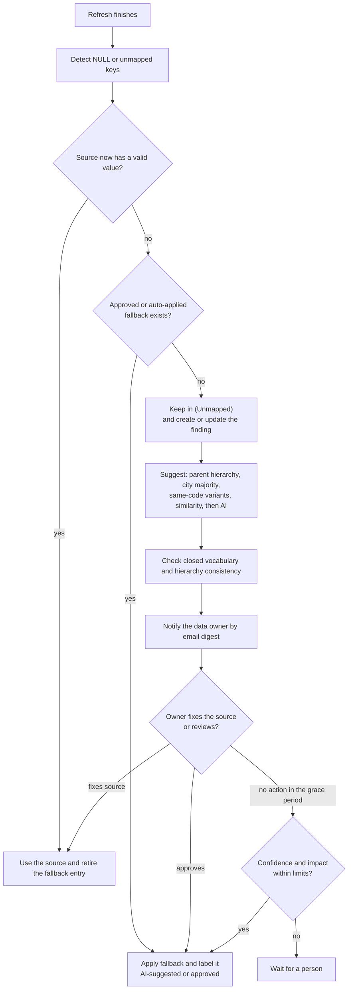

# Mapping Assistant (later feature): fill and normalize unmapped dimension values

Related: [`01-metrics-contract.md`](01-metrics-contract.md) section 13 · [`08-data-findings.md`](08-data-findings.md) · [`07-ai-chat.md`](07-ai-chat.md) · [`02-architecture.md`](02-architecture.md) · [`03-data-model.md`](03-data-model.md)

Tags: `[C]` owner-confirmed, `[P]` proposed, `[O]` open.

## 1. Owner direction (DEC-103)

- `MAP-001` `[C]` A **later feature**, built after Release 1 is finished and validated (the Release 1 behavior stays as in `01` section 13: unmapped values are excluded from dashboards, included in Sales Detail, and reported).
- `MAP-002` `[C]` The feature **fills unmapped header dimension values** that are listed (region, branch, SPV, distributor, city) and **normalizes names** based on the data or the nearest word that already exists in the database.
- `MAP-003` `[C]` **Closed vocabulary:** it never creates a new word. Every suggested value must already exist in the database for that dimension. Code, not the model, enforces this: a suggestion that is not an existing value is rejected.
- `MAP-004` `[C]` Results are stored in a **rename/normalize table** used as a **fallback**: when a refresh still delivers NULL or an unmapped value, the stored corrected value is used.
- `MAP-005` `[C]` The **data owner is informed** of each finding so the master source can be fixed, including **email alerts**.
- `MAP-006` `[C]` If the owner does not fix it, the **AI's best suggestion is used**.

## 2. Recommendations (answering "do you have a better suggestion")

The direction is sound, and the main risk is that **a wrong guess silently moves money between regions**: a distributor placed in the wrong region changes that region's achievement, rankings and the Regional Manager's numbers. These additions keep your design and make it safe:

1. **Rules first, AI last.** Most gaps can be filled with deterministic evidence that is more reliable than a model: the distributor's branch is known and that branch belongs to exactly one region; the city appears elsewhere with one region; the same code appears with a spelling variant; very close string similarity to one existing value. Use the AI only for what is left, and store the **evidence** for every suggestion.
2. **Codes are the identity, names are labels.** Normalize spellings only among rows with the **same code** (`SELLINGPOINTCODE`, `KODEAREA`, branch code). Never merge two entities with different codes just because their names are similar.
3. **Always labelled.** Any figure that depends on a suggestion carries an **"AI-suggested"** badge (and "approved" once reviewed), in tooltips, exports and AI answers, and the reconciliation note shows how much value rests on suggestions.
4. **The source wins.** The fallback applies only while the source value is NULL or unmapped. As soon as a refresh delivers a valid source value, the entry is retired and marked "fixed at source". If the source later delivers a *different* value than the suggestion, that is flagged.
5. **Review, with a grace period, then auto-apply** (this is your "if the owner does not fix it" rule): the data owner or an admin can approve or reject, with a preview of how regional totals would change. If nobody reviews within the **grace period (3 days, owner decision)** and the suggestion meets the confidence rule, it is applied, still labelled and easy to revert. Entries whose impact is above **1% of a region's total** need a person's approval and are never auto-applied.
6. **History is restated visibly.** Owner decision: a fallback applies to **past months (backfill) and to later months**. Because that changes figures already reported, restated values are labelled and dated ("includes fallback applied on <date>"), the impact preview shows the change before approval, and a switch in settings can limit a fallback to forward-only if the owner ever wants that.
7. **Retire the need for it.** Show how long each item has been unmapped and who owns it, send the data owner a list they can correct at the source, and mark entries "fixed at source" so the fallback table shrinks over time.
8. **Send names only to the AI.** Selling point, city and existing region names, never sales values.

## 3. Pipeline

## 4. Requirements

- `MAP-007` `[P]` **Precedence:** source value, then fallback entry, then "(Unmapped)". The fallback never overrides a valid source value.
- `MAP-008` `[P]` **Suggestion order:** (1) hierarchy inference from known parents, (2) city majority, (3) same-code spelling variants, (4) string similarity to an existing value above a threshold, (5) AI. Each step records its evidence; the AI step gets only names and the list of allowed values.
- `MAP-009` `[P]` **Stored per entry:** dimension, source key (code and original value), suggested value, method (`rule`, `similarity`, `ai`, `manual`), evidence, confidence, status (`suggested`, `approved`, `auto_applied`, `rejected`, `superseded`, `fixed_at_source`), effective-from month, created and reviewed by and when.
- `MAP-010` `[P]` **Consistency checks** reject a suggestion that contradicts the hierarchy (for example a branch already known in region A suggested for region B) or is not an existing value (`MAP-003`).
- `MAP-011` `[P]` **Label everywhere:** "AI-suggested" and "approved" badges, an export column, wording in AI chat answers, and a reconciliation line: *mapped at source + mapped by fallback + unmapped = Sales Detail total*.
- `MAP-012` `[P]` **Reversible and audited:** every entry can be rejected or reverted; reverting returns the values to "(Unmapped)" and the reconciliation updates; every change is audited.
- `MAP-013` `[C]` **History policy:** a fallback applies to **all months, past (backfill) and next** (owner, DEC-105). Restated months carry the label and date; the impact preview covers the past months too; the setting `mapping.backfill` (default `all months`, alternative `forward only`) is an admin choice.
- `MAP-014` `[P]` **Privacy:** only names go to the AI provider; the same provider settings and data-sharing acknowledgement as the AI chat apply (`AI-037` to `AI-047`); capability `mapping.suggest`.
- `MAP-015` `[C]` **Notifications:** email is **not set up now**; the owner will fill the SMTP settings in the app after the project is running (DEC-106). Until then, findings, suggestions and "notification pending" status are visible in the app. When email is configured, an email digest per data owner (and an immediate message for large impacts) goes out with a link to the list and the impact, with escalation to a second contact after a set number of days. Contacts per finding category are an admin screen that can be filled before email exists. Other channels such as WhatsApp are a later option (DEC-055). The email settings are in `02-architecture.md` section 17.
- `MAP-016` `[P]` **Review screen** (capability `mapping.review`): list by dimension and status, evidence, confidence, **impact preview** (how regional totals change), approve, reject, bulk approve for rule-based entries, export a "please correct at source" list for the data owner.
- `MAP-017` `[P]` **Normalization table** (alias to canonical value) is separate from the fill table (key to region and parents), but both feed one read-time overlay in the repository layer; the app never writes to `dwh_prod`.
- `MAP-018` `[P]` **Limits:** maximum entries and AI calls per run, rate limits, cost cap, and a dry-run mode that shows what would change without applying.
- `MAP-019` `[P]` **Scope and access:** applying a fallback can change what a Regional Manager sees; the preview shows affected regions and roles. Unmapped rows stay out of regional scopes until a fallback assigns them (`METRIC-048`).
- `MAP-020` `[P]` **Data findings integration:** the `UNMAPPED_REGION` finding shows suggestion, status, owner notified and age, and closes when the source is fixed (`08-data-findings.md`).

## 5. Tests

- A suggestion that is not an existing value is rejected; a suggestion that contradicts the hierarchy is rejected; names with different codes are never merged.
- A valid source value always wins; when the source is fixed the entry becomes `fixed_at_source`; a conflicting later source value raises a flag.
- Grace period is 3 days and the impact limit is 1% of the region's total; entries above the limit are never auto-applied; backfilled months carry the restatement label; `mapping.backfill = forward only` limits a fallback to later months.
- With email not configured, nothing is sent, findings show "notification pending", and no backlog is mailed later: after configuration only the current digest is sent.
- Dry run changes nothing; approve, reject and revert update totals and the reconciliation line exactly; backfill needs its own approval.
- Large-impact entries are never auto-applied; grace-period auto-apply labels the result.
- Only names are sent to the AI (test with a mock provider that records the payload).
- Email digest contents and escalation timing; no email when nothing changed.
- Regional Manager totals before and after a fallback match the impact preview.

## 6. Open decisions

DEC-104, DEC-105 and DEC-106 are answered (3-day grace period and 1% impact limit; backfill and next months; email settings filled later). The data-owner contact list is filled by the owner in the app. See `decisions.md`.
